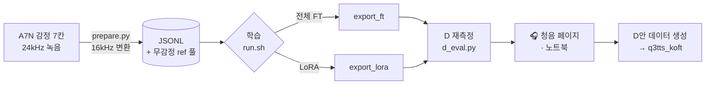

<div align="center">

# 🎙️ vox_koft

### VoxCPM2 한국어 감정 Fine-tune — 전체 FT · LoRA

**"(감정 지시문)문장" + 처음 듣는 목소리 한 마디 → 그 사람 목소리로, 지시한 감정대로**


</div>

> **English summary** — Korean emotional fine-tuning of **VoxCPM2** (2B, 48 kHz) with both full fine-tuning and LoRA.
> Input: `"(English emotion description)Korean sentence"` + a neutral reference clip of an unseen speaker → speech in that speaker's voice with the instructed emotion.
> Our trainer wraps the official model/packer/LoRA with exact resume, atomic exports, GPU-count-independent validation, and grouped TensorBoard.
> Evaluation ("D re-measurement") uses 16 unseen speakers × 7 emotion cells with WavLM/ERes2Net speaker ranking, emotion2vec/arousal, Whisper CER, SQUIM, and a virtual-speaker consistency check.
> Main use: generating emotional data in new voices for the sister project [q3tts_koft](https://github.com/renslightsaber/q3tts_koft). The upstream `VoxCPM/` is never modified. Documentation is in Korean.

---

## ✨ 이 프로젝트는

[VoxCPM2](https://github.com/OpenBMB/VoxCPM)(2B · 48kHz 출력)는 괄호 지시문 `"(감정 묘사)문장"` 으로 말투를 바꿀 수 있습니다. 하지만 **한국어에서는 감정이 약하게 나왔습니다**.
이 저장소는 한국어 감정 데이터(A7N · 감정 7칸)로 VoxCPM2 를 **전체 FT · LoRA** 두 방식으로 학습하고, 결과를 같은 잣대로 평가합니다.

| 목표 | 설명 |
|---|---|
| 🎭 감정 | 지시문만으로 기쁨 · 슬픔 · 분노(약 · 강)와 중립이 나오게 |
| 🗣️ 목소리 | 무감정 reference 하나만 주면, 감정을 실어도 그 사람 목소리를 유지 |
| 🧪 데이터 증강 | 다른 목소리로 감정 문장을 만들어 자매 프로젝트 [q3tts_koft](https://github.com/renslightsaber/q3tts_koft) 의 학습 데이터를 늘림(D안) |

```text
입력:  reference = 목표 화자의 무감정 녹음 한 마디
       text      = "(Very happy and excited, bright, cheerful and openly joyful)오늘 정말 좋은 소식이 있어요!"
출력:  목표 화자 목소리 · 기쁜 말투 · 48kHz
```

---

## 📊 지금까지의 결과 (2026-11-06 · 숫자는 참고용, 판정은 청음)

본 학습 4개(전체 FT 2 · LoRA 2)를 마쳤습니다. **처음 보는 화자 16명**에 대해 원본 VoxCPM2 와 같은 입력으로 비교했습니다.

| 지표 (감정 6칸) | 원본 | FT · LoRA |
|---|---|---|
| 🗣️ 목표 화자 1위 (WavLM) | 67% | **74 ~ 90%** |
| 🔤 발음 CER | 5.7% | **1.8 ~ 3.1%** |
| ✂️ 끝 잘림 | 5.2% | **0 ~ 0.5%** |
| 🎭 감정 맞힘 (emotion2vec) | 47% | 49 ~ 64% |
| 👥 가상 화자 일관성 (7칸이 한 사람인가) | 85% | 상위 **96 ~ 97%** (진짜 녹음 98%) |

- 목소리 · 발음 · 안정성은 뚜렷이 좋아졌습니다. LoRA 가 reference 목소리를 더 잘 따라갑니다.
- 감정 세기는 원본처럼 과장되지 않고, **A7N 진짜 녹음과 비슷한 세기**입니다.
- 자세한 내용: [본 학습 4개 결과](docs/reports/20261106_A7N_4runs_results.md) · [중립 칸 · 가상 화자 일관성](docs/reports/20261106_neutral_cell_virtual_speaker.md)

---

## 🧭 전체 흐름



학습 한 줄의 모양은 추론과 똑같습니다:
`[ref 무감정 소리] + "(영어 감정 지시문)한국어 문장"` → `정답 감정 소리`
(공식 packer · loss 사용 · 자세한 해설: [학습 코드 해설](docs/reference/voxcpm2_training_code_walkthrough.md))

---

## 🚀 빠른 시작

### 1) 받기
외부 코드 두 개가 **git submodule** 로 연결돼 있습니다. `--recursive` 를 꼭 붙이세요.

```bash
git clone --recursive https://github.com/renslightsaber/vox_koft.git
# 사내 GitLab 미러도 있습니다(주소는 팀 안내 참고)
cd vox_koft
# 이미 받았다면: git submodule update --init --recursive
```

| 폴더 | 무엇 |
|---|---|
| `VoxCPM/` | 공식 OpenBMB/VoxCPM (커밋 `cce58a5`) — 🔒 수정하지 않음 |
| `ko-tts-text-normalizer/` | 한국어 TTS 텍스트 정규화기 (`import ko_tts_norm`) |

### 2) 환경 설치
conda env **`voxcpm`** (Python 3.12 · torch 2.8.0+cu128 · flash-attn) — 자세한 순서는 [requirements_112/README.md](requirements_112/README.md)

```bash
bash requirements_112/install_voxcpm_env.sh      # q3tts env 를 복제한 뒤 VoxCPM · 정규화기 · voxko 설치 (서버 112 기준)
conda activate voxcpm
python tools/download_ckpts.py                   # VoxCPM2 → ~/workspaces/ourckpts/voxcpm/VoxCPM2
CUDA_VISIBLE_DEVICES=0 python requirements_112/verify_install.py   # 한국어 합성 1개로 설치 확인
```

### 3) 데이터 준비
```bash
python -m voxko.data.prepare a7n --limit 100     # 먼저 100문장 smoke
python -m voxko.data.prepare a7n --workers 32    # 전체 → ~/workspaces/preprocessed/vox_koft/A7N/
```
감정 지시문은 데이터에 굽지 않고 **학습할 때 붙입니다**. 그래서 지시문 표(`configs/emotion/*.yaml`)를 바꿔도 다시 변환할 필요가 없습니다.

### 4) 학습
```bash
# ① 짧은 smoke 먼저 (몇 step · 저장 · 합성까지 확인)
./scripts/run.sh train sft  --exp configs/experiments/sft/A7N100_ref_FT_00_smoke.yaml   --hw rtxpro6000_1gpu --gpu 0 --smoke

# ② 본 학습 (예: GPU 2,3 두 장)
./scripts/run.sh train sft  --exp configs/experiments/sft/A7N_ref_FT_01.yaml        --hw rtxpro6000_2gpu --accel 2gpu_b
./scripts/run.sh train lora --exp configs/experiments/lora/A7N_ref_LoRA_01_r32.yaml --hw rtxpro6000_2gpu --accel 2gpu_b

# ③ 끊겼다면 이어서
./scripts/run.sh train sft  --exp configs/experiments/sft/A7N_ref_FT_01.yaml        --hw rtxpro6000_2gpu --accel 2gpu_b --resume
```
- 설정 = `configs/config.yaml`(기본) + `hardware/` + `experiments/` 3축 병합 · 모르는 키는 에러 · 한 값만 바꿀 땐 `--set train.lr=…`
- TensorBoard: `./scripts/tb.sh` → http://localhost:6008 (학습 방식 / 데이터 / run 으로 묶어 보여 줌)
- 안내: [전체 FT](docs/guides/sft_training.md) · [LoRA](docs/guides/lora_training.md) · [TensorBoard 그룹](docs/guides/tensorboard_groups.md)

### 5) 합성
```python
import os
from voxko.engine.synth import Engine

ckpt = os.path.expanduser("~/workspaces/outputs/vox_koft/ckpt/A7N_ref_LoRA_01_r32/step_1500/export_lora")
eng = Engine(ckpt,
             emotion_map="configs/emotion/a7n_vox_v1.yaml")      # 원본 · export_ft · export_lora 모두 OK
text = eng.compose("오늘 정말 좋은 소식이 있어요!", emotion="Happy-B")   # → "(지시문)문장" + 한국어 정규화
wav = eng.synth(text, ref="target_neutral.wav", seed=1986)          # 48kHz numpy
```
> 🔴 한국어는 `normalize=False` + `ko_tts_norm` 을 씁니다. VoxCPM 내장 정규화는 숫자를 영어로 읽습니다.
> 🔴 같은 seed 라도 모델을 불러온 뒤 **첫 합성만** 값이 달라서, Engine 이 준비 합성을 1번 자동으로 합니다.

### 6) 평가 · 청음
```bash
python tools/eval_runs.py --runs A7N_ref_FT_01 A7N_ref_LoRA_01_r32 --gpus 2 3   # 대표 step 들을 D 재측정
python notebooks/utils/build_listening_nb.py --runs A7N_ref_FT_01                 # run 별 청음 노트북(커널 voxcpm)
```
- **D 재측정**: 처음 보는 화자 16명 × 감정 7칸 · 원본과 같은 입력 비교
  - 🗣️ 목소리: WavLM-large · ERes2Net 두 잣대
  - 🎭 감정: emotion2vec · arousal
  - 🔤 발음: whisper CER
  - ✂️ 깨짐: SQUIM · 긴 무음 · 끝 잘림
- 🎧 **청음이 정본**입니다. 숫자는 들을 후보를 좁히는 데 씁니다. 청음 페이지에서 버튼으로 판정하고 CSV 로 받을 수 있습니다.

---

## 🗂️ 폴더 구조

```text
vox_koft/
├── voxko/                  # 우리 패키지
│   ├── common/             #   설정 3축 병합 · 정확한 재개(TrainState) · sampler · 체크포인트 · 트레이너 틀
│   ├── data/               #   A7N/542 → 16kHz JSONL · "(지시문)문장" + 무감정 ref Dataset
│   ├── sft/ · lora/        #   전체 FT · LoRA 트레이너 (HF accelerate · 1/2/4 GPU · bf16)
│   ├── engine/             #   합성 엔진 (원본 · FT · LoRA)
│   ├── eval/               #   D 재측정 · 지표
│   └── listen.py           #   청음 노트북 도우미
├── configs/                # config.yaml(스키마) · hardware/ · accelerate/ · emotion/(지시문 표) · experiments/
├── scripts/                # run.sh(학습 실행) · tb.sh(TensorBoard) · runs/(여러 run 연속 실행)
├── tools/                  # 학습 전후 백업 · 평가 일괄 실행 · 가상 화자 일관성 · 표 정리 · TB 그룹
├── notebooks/              # run 별 청음 노트북 (저장소에는 출력 지운 사본)
├── exp_reports/            # run 별 설정 백업 · 학습 곡선 · TB 수치 CSV
├── docs/                   # 규칙 · 가이드 · 참고 · 보고서 · 계획 · history
├── tests/                  # CPU 단위 테스트 (pytest)
├── _handoff/               # 작업 인수인계 (가장 최근 문서부터 읽기)
├── VoxCPM/                 # 🔒 submodule — 공식 코드
└── ko-tts-text-normalizer/ # submodule — 한국어 정규화
```

체크포인트 · 데이터 · TensorBoard · 합성음은 **저장소 밖**에 있습니다:
`~/workspaces/outputs/vox_koft/{ckpt,runs}` · `~/workspaces/preprocessed/vox_koft/` · `~/workspaces/tmp_listen/vox_koft/`

---

## 📚 어디서부터 읽나요?

| 하고 싶은 일 | 문서 |
|---|---|
| 프로젝트 규칙 · 구조 한눈에 | [`CLAUDE.md`](CLAUDE.md) |
| 문서 전체 목차 | [`docs/README.md`](docs/README.md) |
| 공식 학습 코드가 어떻게 돌아가나 · 무엇을 고쳤나 | [`docs/reference/voxcpm2_training_code_walkthrough.md`](docs/reference/voxcpm2_training_code_walkthrough.md) |
| 성공 기준 · 다음 run 후보 | [`docs/plan/20261105_success_criteria_and_next_runs.md`](docs/plan/20261105_success_criteria_and_next_runs.md) |
| 데이터(A7N) 설명 | [`docs/datasets/A7N_vox_koft.md`](docs/datasets/A7N_vox_koft.md) |
| run 이름 · GPU · 평가 · 문서 규칙 | [`docs/rules_in_this_proj/`](docs/rules_in_this_proj/README.md) |
| 최근 진행 상황 | [`_handoff/`](_handoff/) 의 가장 최근 문서 |

---

## 🛠️ 우리가 공식 학습 스크립트 대신 쓰는 것

공식 `train_voxcpm_finetune.py` 대신 **우리 트레이너**에 공식 부품(모델 forward · packer · LoRA)을 끼워 씁니다.

| 공식 스크립트의 문제 | 우리 쪽 |
|---|---|
| resume 때 데이터 위치 · RNG 를 복원하지 않음 | TrainState 로 **데이터 위치까지 정확히 재개** |
| 저장이 원자적이지 않음 · 보관 개수 제한 없음 | export → 검증 → `_COMPLETE` · 개수 제한 |
| train 지표 = 한 GPU 의 마지막 micro-batch | 전 GPU 합계 / target 칸 수 |
| val 표본이 GPU 수에 따라 달라짐 | GPU 수와 무관한 같은 표본 |
| 공식 추론 스크립트가 V1 LoRAConfig 를 import | V2 LoRAConfig 로 저장 · 불러오기 |

---

## 📝 노트북을 고쳐서 커밋하려면
노트북은 **출력을 지운 사본**으로 올라갑니다. 받은 뒤 한 번 필터를 등록하세요. 그러면 커밋할 때 출력이 자동으로 지워지고, 내 컴퓨터의 노트북은 그대로 남습니다.

```bash
git config filter.nbstrip.clean "jupyter nbconvert --ClearOutputPreprocessor.enabled=True --to notebook --stdin --stdout --log-level=ERROR"
git config filter.nbstrip.smudge cat
```

---

<div align="center">

**관련 프로젝트** · [q3tts_koft](https://github.com/renslightsaber/q3tts_koft) (Qwen3-TTS 한국어 감정 FT) · [ko-tts-text-normalizer](https://github.com/renslightsaber/ko-tts-text-normalizer) · [OpenBMB/VoxCPM](https://github.com/OpenBMB/VoxCPM)

</div>
