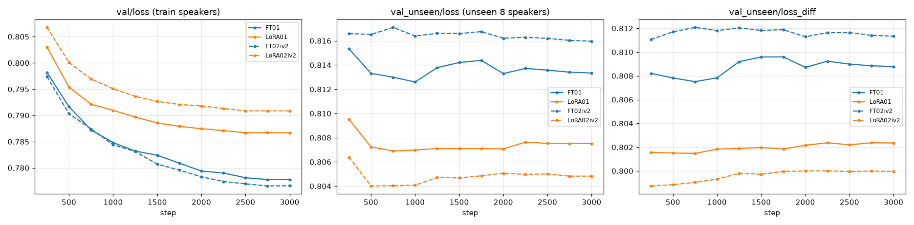
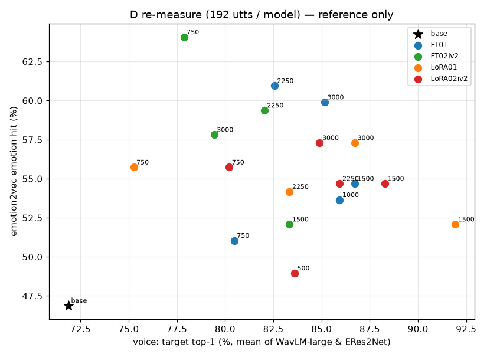

# 본 학습 4개 결과 — D안 데이터 생성에 쓸 수 있는가 (전체 FT · LoRA · 웹 조사판)

> 📅 2026-11-06 04:15 KST · 처음 보는 사람용 · 숫자는 모두 **참고용**(자동 잣대) — **판정은 사용자 청음**
> 관련: [성공 판정 기준](../plan/20261105_success_criteria_and_next_runs.md) · [사전 점검](20261106_four_runs_preflight.md) · 청음 페이지 `http://127.0.0.1:8765/vox_koft/d_eval/index.html` · 노트북 `notebooks/{sft,lora}/*_listening.ipynb`

---

## 0. 한눈에

| 질문 | 자동 잣대(참고) | 비고 |
|---|---|---|
| 학습 4개는 정상인가 | ✅ 모두 정상 종료 · 저장 12개씩 · 오류 0 · 설정 = 학습 전 백업 | 시간 · 디스크도 예상과 같음 |
| **목소리가 목표 화자를 따라가나** | ✅ **원본보다 좋아짐** — 목표 1위 원본 67% → FT · LoRA 74~90% | 처음 보는 화자 16명 · 같은 성별 후보 142명 중 1위 |
| 발음 · 깨짐 | ✅ 좋아짐 — CER 5.7% → 1.8~3.1% · 끝 잘림 5.2% → 0~0.5% | 빈 합성 · 안 끝나는 합성 0 |
| **감정이 원본보다 세졌나** | ⚠️ **"세지지는 않음 — A7N 진짜 녹음 수준으로 맞춰짐"** | 아래 설명 |

- 감정 해석이 성공 판정의 핵심이라 아침에 귀로 확인이 필요합니다.
  - **감정 세기(arousal)**: 원본이 진짜 녹음보다 과장돼 있었습니다(분노B 0.94 vs 진짜 0.71). FT · LoRA 는 **진짜 녹음과 거의 같은 세기**로 내려왔습니다.
  - **감정 이름 맞힘(emotion2vec)**: 원본 47% → 49~64%. 진짜 녹음도 57~74% 라서, 이 잣대로는 이미 천장 근처입니다.
    - 기쁨A · 슬픔B · 분노A 는 크게 올랐습니다. **기쁨B 는 떨어졌습니다**(50% → 9~41%).
  - 그래서 "원본보다 확실히 세짐"은 숫자로는 아닙니다. 대신 "**A7N 처럼 자연스러운 감정 + 목표 목소리**"가 됐을 가능성이 큽니다. 이것을 성공으로 볼지는 **사용자 결정**입니다(§7).
- 후보(참고 점수 상위 · 성격이 다름)

| 후보 | 성격 | 목표 1위 W/E | 감정 | CER |
|---|---|---|---|---|
| `LoRA01_s1500` | 목소리 최고 | 90/94% | 52% | 2.6% |
| `FT01_s3000` | 균형 | 84/86% | 60% | 2.8% |
| `LoRA02iv2_s1500` | LoRA 웹 조사판 | 82/94% | 55% | 3.1% |
| `FT02iv2_s750` | 감정 최고 · 목소리 낮음 | 74/82% | 64% | 3.1% |

## 1. 학습 결과
| run | 걸린 시간(예상) | 저장 | val 최저(학습 화자) | val_unseen 최저(처음 보는 화자) |
|---|---|---|---|---|
| `A7N_ref_FT_01` | 1:04(66분) | 12 · 오류 0 | s3000 0.7778 | **s1000** 0.8126 |
| `A7N_ref_LoRA_01_r32` | 0:33(34분) | 12 · 오류 0 | s3000 0.7867 | **s750** 0.8069 |
| `A7N_ref_FT_02_iv2` | 1:02(72분) | 12 · 오류 0 | s2750 0.7766 | s3000 0.8160 |
| `A7N_ref_LoRA_02_r32_iv2` | 0:32(37분) | 12 · 오류 0 | s3000 0.7909 | **s500** 0.8040 |
- 실행: 11/06 00:18 ~ 03:32 KST · GPU 2,3 · 연속 실행 스크립트(실패 · 중단 없음).
- 디스크: FT 82GB × 2 · LoRA 9.6GB × 2 = 183GB(예상 185GB).
- 모두 학습 전 백업과 설정이 같습니다(`exp_reports/*/<run>/run_backup/analysis.json`). 경고는 토크나이저 클래스 안내 1개뿐입니다(무해).

- 학습 화자 val 은 끝까지 내려갑니다. **처음 보는 화자 val 은 거의 평평**합니다(앞쪽 500~1000 step 이 최저, 그 뒤 ±0.002).
- LoRA 가 FT 보다 처음 보는 화자 val 이 낮습니다(일반화가 덜 깨짐 · 가설).
- ⚠️ v1(1·2번)과 iv2(3·4번)는 val 에도 다른 지시문 · ref 규칙이 걸려서 **val 숫자를 서로 직접 비교할 수 없습니다**.

## 2. D 재측정 (성공 판정 · 모델당 192문장)
- 입력: `"(v1 지시문)문장"` + 처음 보는 화자 16명(542 여4 · 남4 + unseen8)의 무감정 reference. prompt 없음 · seed 1986.
- 평가 step: run 마다 750 · 1500 · 2250 · 3000 + TB 처음 보는 화자 val 최저 step, 모두 18개 모델입니다.
  - 저장 step 전부(48개)는 약 4시간이 걸려서 줄였습니다.
  - 합성 · 채점은 03:43 ~ 04:05 KST 에 GPU 4장으로 했습니다(그때 GPU 0,1 이 비어 있었음).
- 재현: 18개 모두 같은 seed 로 다시 합성하면 같은 소리가 납니다. 노트북 엔진으로도 페이지 wav 를 똑같이 재현했습니다(FT · LoRA 각 2문장).

| 모델 | 목표 1위 WavLM / ERes2Net | 목표 유사도 | e2v 감정 | CER | 이상* | 참고 점수** |
|---|---|---|---|---|---|---|
| **원본(base)** | 67 / 77% | 0.543 | 47% | 5.7% | 14% | 99 |
| FT01 s750 / 1000 / 1500 / 2250 / **3000** | 79 / 84 / 83 / 79 / **84%** | ~0.60 | 51 / 54 / 55 / 61 / **60%** | 1.8~2.9% | 2~9% | 120 / 134 / 136 / 138 / **140** |
| LoRA01 s750 / **1500** / 2250 / 3000 | 73 / **90** / 81 / 87% | ~0.62 | 56 / **52** / 54 / 57% | 2.2~2.6% | 2~6% | 123 / **140** / 133 / 139 |
| FT02iv2 s750 / 1500 / **2250** / 3000 | 74 / 80 / **79** / 74% | ~0.58 | **64** / 52 / **59** / 58% | 2.5~3.1% | 3~7% | 132 / 130 / **134** / 130 |
| LoRA02iv2 s500 / 750 / **1500** / 2250 / 3000 | 81 / 78 / **82** / 83 / 82% | ~0.62 | 49 / 56 / **55** / 55 / 57% | 2.2~5.0% | 1~3% | 125 / 131 / **138** / 138 / 138 |

\* 이상 = 빈 합성 · 안 끝남 · 중간 무음 ≥ 0.8초 · 클리핑 · 끝 잘림 · SQUIM(STOI · PESQ · SI-SDR) 이 원본 하위 5% 보다 낮음 중 하나라도. 원본은 문턱을 자기 하위 5% 로 잡아서 정의상 5% 가 깔려 있습니다.
\*\* 참고 점수 = e2v 감정 + 목표 1위(두 잣대 평균) − CER − 이상. 후보를 좁히는 용도일 뿐입니다.

### 2-1. 감정 — 칸별 (e2v 맞힘 % / arousal) · 진짜 녹음과 나란히
| | 기쁨A | 기쁨B | 슬픔A | 슬픔B | 분노A | 분노B |
|---|---|---|---|---|---|---|
| **진짜 녹음 A7N val**(학습 화자 · 212) | 59 / 0.58 | 57 / 0.67 | 59 / 0.41 | 58 / 0.54 | 68 / 0.64 | 74 / 0.71 |
| 진짜 녹음 unseen8(76 · 칸당 4~18) | 53 / 0.60 | 88 / 0.69 | 44 / 0.42 | 100 / 0.56 | 61 / 0.64 | 25 / 0.73 |
| 원본 | 31 / 0.56 | 50 / **0.78** | 22 / 0.48 | 28 / **0.64** | 56 / 0.70 | 94 / **0.94** |
| FT01 s3000 | 59 / 0.55 | 34 / 0.71 | 38 / 0.42 | 56 / 0.53 | 78 / 0.58 | 94 / 0.79 |
| LoRA01 s1500 | 47 / 0.51 | **9** / 0.74 | 28 / 0.46 | 78 / 0.50 | 66 / 0.60 | 84 / 0.78 |
| FT02iv2 s2250 | 66 / 0.58 | 41 / 0.74 | 31 / 0.45 | 50 / 0.57 | 81 / 0.62 | 88 / 0.83 |
| LoRA02iv2 s1500 | 38 / 0.49 | 34 / 0.72 | 31 / 0.42 | 53 / 0.47 | 78 / 0.67 | 94 / 0.81 |
- FT · LoRA 의 **arousal 은 진짜 녹음과 ±0.05 안**입니다(분노B 만 +0.08~0.12). 원본은 B 칸에서 +0.1~0.23 높았습니다(과장).
- A < B 세기 순서는 모든 모델에서 유지됩니다.
- **기쁨B 의 e2v 맞힘이 낮습니다**(9~41%). 진짜 녹음은 57% 입니다. 귀로 확인이 필요합니다. emotion2vec 이 다른 감정(놀람 등)으로 본 것일 수도 있습니다(가설 · 확인 안 함).
- emotion2vec 은 한국어 슬픔을 잘 못 잡는다는 기존 관찰이 있어서, 슬픔 숫자는 특히 참고만 하세요.

### 2-2. 목소리 — 처음 보는 화자 16명
| 모델 | 542 8명 W/E | unseen8 8명 W/E |
|---|---|---|
| 원본 | 56 / 66% | 78 / 88% |
| FT01 s3000 | 83 / 84% | 85 / 88% |
| LoRA01 s1500 | 91 / 93% | 90 / 95% |
| FT02iv2 s2250 | 72 / 82% | 85 / 89% |
| LoRA02iv2 s1500 | 81 / 95% | 83 / 94% |
- 목소리가 원본보다 **좋아졌습니다**. 특히 542 화자에서 크게 올랐습니다.
- 공식 이슈 #317("감정 지시문이 음색을 바꾼다")의 우려와 달리, FT 뒤에 목표 목소리 쪽으로 더 갑니다.
- 다만 원본이 감정을 과장하면서 목소리가 흔들렸던 몫이 줄어든 효과일 수 있습니다(가설).
- 진짜 녹음(대조)은 1위 100% 입니다.

### 2-3. 깨짐 · 이상
| 모델 | STOI | PESQ | 끝 잘림 | 중간 긴 무음 | 말 속도 | 평균 길이 |
|---|---|---|---|---|---|---|
| 원본 | 0.974 | 3.66 | 5.2% | 1.6% | 6.1 음절/초 | 2.7초 |
| FT01 s3000 | 0.990 | 3.75 | 0% | 1.0% | 5.8 | 3.1초 |
| LoRA01 s1500 | 0.992 | 3.82 | 0% | 0.5% | 5.9 | 3.1초 |
| FT02iv2 s2250 | 0.988 | 3.73 | 0.5% | 1.0% | 5.9 | 3.1초 |
| LoRA02iv2 s1500 | 0.992 | 3.75 | 0.5% | 0% | 5.8 | 3.1초 |
- 빈 합성 · 안 끝나는 합성(96초 상한) · 클리핑은 모든 모델에서 0 입니다.
- FT 뒤에 끝 잘림이 거의 사라졌고, 말이 조금 느려졌습니다(A7N 말투).

## 3. 비교 (참고)
| 비교 | 관찰 |
|---|---|
| **FT vs LoRA** | LoRA 가 **목소리**에서 앞섭니다(90% · 학습 약 2배 빠름 · 디스크 약 1/8). FT 는 **감정 맞힘**에서 조금 앞섭니다(60 vs 52~57%). 품질은 비슷합니다 |
| **v1 vs iv2**(지시문 4문구 · 0.9 · ref 0.5) | 뚜렷한 차이는 없습니다. iv2 FT 는 앞쪽(s750)에서 감정이 가장 높지만(64%) 목소리가 낮습니다(74%). iv2 LoRA 는 v1 LoRA 와 비슷합니다. **ref 0.5 가 목소리를 해치지는 않았습니다** |
| step | 750 은 대체로 덜 익었습니다(이상 비율 ↑). 1500 이후는 비슷합니다. TB 처음 보는 화자 val 최저 step(500~1000)이 D 재측정 최고 step 은 아니었습니다 → **step 은 청음 · D 재측정으로 고릅니다**(공식 조언과 같음) |

### 3-1. 참고 점수 best 5 (전체 18개 중)
1. `FT01_s3000` 140
2. `LoRA01_s1500` 140
3. `LoRA01_s3000` 139
4. `FT01_s2250` 138
5. `LoRA02iv2_s1500` · `s2250` · `s3000` 138(동점)

- 청음 페이지 열 = 원본 + run 별 1등(`FT01_s3000` · `LoRA01_s1500` · `FT02iv2_s2250` · `LoRA02iv2_s1500`).

## 4. 청음 자료 (아침에)
- **D 재측정 페이지**: http://127.0.0.1:8765/vox_koft/d_eval/index.html
  - 16명 × 12문장, 각 출력마다 목소리 · 감정 버튼이 있고 CSV 로 받을 수 있습니다.
  - 숫자는 "숫자 보기"를 켜거나 맨 아래 접힌 요약에서 봅니다.
- **노트북**: `notebooks/sft/A7N_ref_FT_01_listening.ipynb` · `A7N_ref_FT_02_iv2_…` · `notebooks/lora/A7N_ref_LoRA_01_r32_…` · `A7N_ref_LoRA_02_r32_iv2_…`
  - 커널 "Python (voxcpm)" · 셀 2 에 best 5 주석이 있습니다.
  - `LISTEN_SMOKE=1` 로 4개 모두 실행 확인했습니다(오류 0 · 출력은 scratch 사본에만 · 노트북 원본은 출력 없음).
- 귀로 볼 것
  1. 기쁨B 가 정말 약해졌는지(e2v 9~41%)
  2. 분노B · 기쁨B 가 원본처럼 과장되지 않은 것이 좋은지 아쉬운지
  3. 542 여성 화자에서 목소리가 끝까지 유지되는지

## 5. 확인 · 기록한 것
- 종료 확인 · 학습 뒤 백업(`tools/post_train_backup.py` 새로 만듦): 4개 모두 `Training End` · `_COMPLETE` 12 · 재개용 파일 마지막 1개 · `_EXPORT_FAILED` 0 · 설정 = 학습 전 백업. `run_backup/`(로그 · 읽기 쉬운 로그 · 실행 스냅샷 · TB CSV · val 표 · analysis · md5) · `curves.png`.
- `scripts/run.sh` 를 TB 새 규칙 판으로 교체했습니다(4개가 끝난 03:43). 이전 판은 scratch 에 보관했습니다.
- 진짜 녹음 감정 수치: `tmp_listen/vox_koft/d_eval/real_ser.json`.

## 6. 한계
- emotion2vec · arousal 은 한국어 감정을 일부만 잡습니다(진짜 녹음도 57~74%). **귀가 정본**입니다.
- 칸당 32문장(16명 × 2)이라 칸별 숫자는 ±10%p 정도 흔들릴 수 있습니다(가설).
- 평가 문장 12개는 A7N val 에서 골랐습니다(학습 화자의 문장 스타일 · 학습에는 안 씀).

## 7. 결정이 필요한 것 → 인수인계 맨 위 목록
