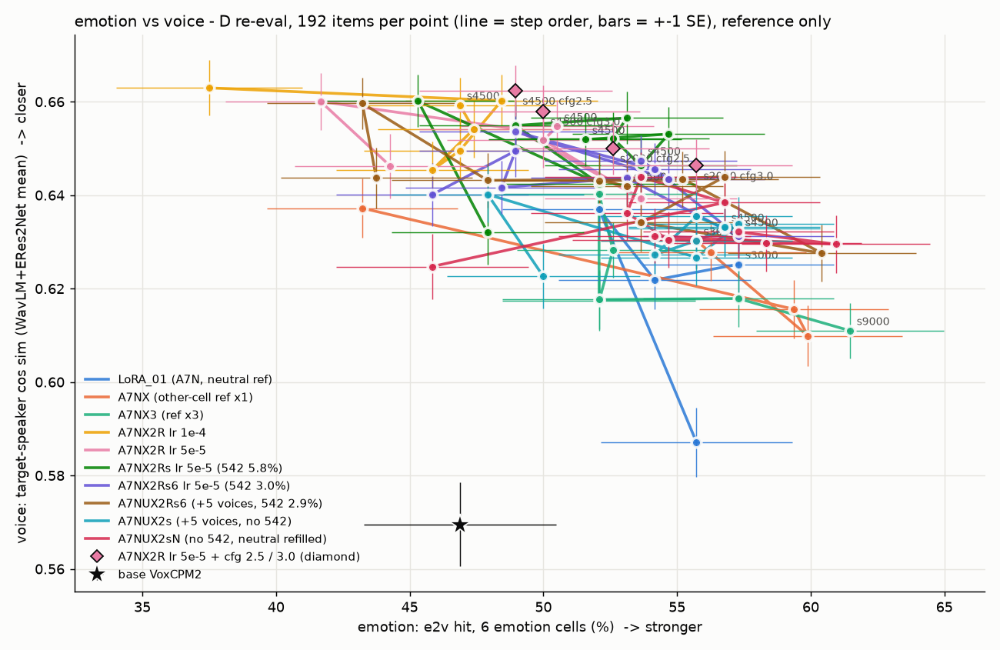
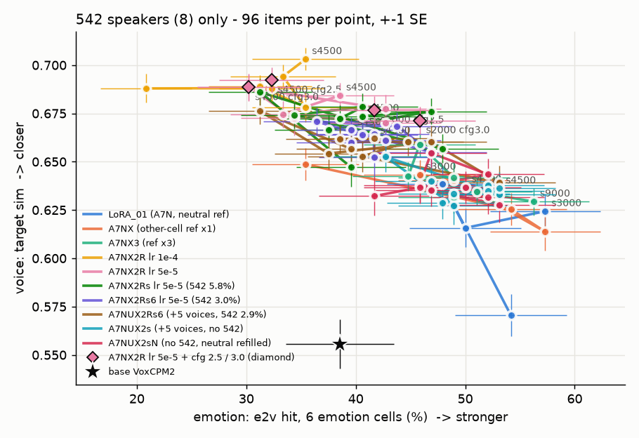
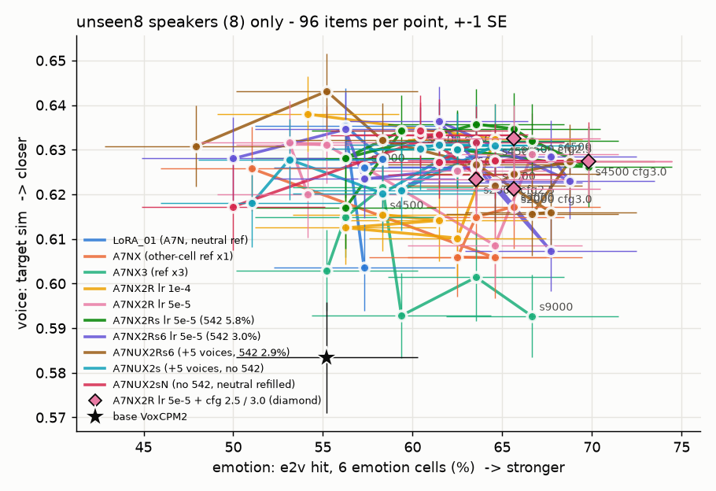

# A7NUX2sN 결과 — 542 화자 감정 약화의 원인은 거의 "542 행" 쪽

> 📅 2026-11-07 23:25 KST · 지시문: q3tts 세션 21:45(`_handoff/20261107_2145_prompt_a7nux2sn_full.md`) §3-4
> 숫자는 모두 **참고용**이고, 판정은 청음으로 합니다. 이전 보고서: [20261107_A7NU_results.md](20261107_A7NU_results.md)

---

## 0. 한 줄 요약
- **542 A칸 e2v 9 step 평균은 41.0% 입니다.** A7NUX2s(42.1%) 쪽이고, A7NUX2Rs6(31.7%) 쪽이 아닙니다.
  - 그래서 원인은 거의 **(가) 542 지름길** 입니다.
  - 나누어 보면 A7NUX2Rs6 → A7NUX2s 의 +10.4%p 가운데 다음과 같습니다.
    - **약 +9.3%p(약 90%)는 542 행을 뺀 효과**입니다(Rs6 → sN, 무감정 비율은 그대로).
    - **약 +1.1%p 만 무감정 비율 효과**입니다(sN → s, 잡음 범위).
- **542 화자 목소리도 (가) 를 따라갑니다.** 542 A 유사도가 Rs6 0.687 · s 0.669 · **sN 0.668** 입니다. 감정이 돌아온 만큼 목소리가 조금 덜 닮는 맞바꿈입니다.
- **unseen8 A칸 e2v 는 A7NUX2Rs6 쪽으로 돌아왔습니다**(Rs6 63.0% · s 55.8% · **sN 61.1%**).
  - A7NUX2s 에서 보였던 unseen8 하락(−7%p)은 무감정 비율 쪽 효과이거나 잡음으로 보입니다.
  - 그래서 sN 은 542 A칸 감정을 되찾으면서 unseen8 도 잃지 않은 판입니다.
- ⚠️ 해석 주의: 추가 무감정 행의 ref 는 **모두 감정 녹음**입니다. 542 행은 "무감정 ref → 무감정 정답"이었습니다(§3).
  - 그래서 정확히 말하면 "542 화자라서"인지 "**무감정 ref → 무감정 정답 행이라서**"인지는 이 판으로도 가를 수 없습니다.
- 통합 참고 점수: **A7NUX2sN s3000 = 144.9** 로, 지금까지 1위였던 X2Rs6 s4500(144.7)과 같은 수준입니다(소수점까지 보면 근소하게 1위). 9 step 평균은 세 A7NU 판 가운데 가장 높습니다(140.2).
- 청음 추천: **A7NUX2sN s3000**(D 재측정 페이지 새 열)을 A7NUX2s s4500 · A7NUX2Rs6 s3500 · X2Rs6 s4500 과 542 화자 A칸 위주로 비교해 주세요.

## 1. 무엇을 했나
| 데이터 | 행 | 542 행 | 무감정 비율 | run |
|---|---|---|---|---|
| A7NUX2Rs6 | 206,570 | 5,941 | 10.7% | `A7NUX2Rs6_xref_LoRA_01_r32_lr5e5` |
| A7NUX2s | 200,629 | 0 | 8.05% | `A7NUX2s_xref_LoRA_01_r32_lr5e5` |
| **A7NUX2sN** | **206,570** | **0** | **10.69%** | `A7NUX2sN_xref_LoRA_01_r32_lr5e5` |

- A7NUX2sN = A7NUX2s 의 모든 행 + 무감정 정답 5,941행입니다(542 자리를 A7N · A7NU 무감정으로 채움).
  - 추가 행: A7N 5,506 · A7NU 435 · 화자 53명 · ref 종류 A 3,405 / B 2,536
  - 만든 코드: `tools/make_a7nux2rs6.py --n542 0 --neu_fill`(q3tts 세션)
  - vox 세션 확인
    - 검사 8개 모두 0
    - A7NUX2s ⊂ sN · A7NUX2Rs6 의 542 아닌 행 ⊂ sN
    - val_xref = A7NUX2Rs6 것과 같음
    - 무작위 20행의 소리 40개가 16kHz 로 열림
- 학습: 21:56 ~ 22:46 KST(50분) · Claude nohup · GPU 2,3(사용자 승인 21:36). 평가 22:47 ~ 23:17.
- 설정 차이(A7NUX2s 대비): 아래 세 줄과 머리 주석뿐입니다.

```diff
-  run_name: A7NUX2s_xref_LoRA_01_r32_lr5e5
+  run_name: A7NUX2sN_xref_LoRA_01_r32_lr5e5
-  train_jsonl: A7NUX2s/train.jsonl
+  train_jsonl: A7NUX2sN/train.jsonl
-  val_xref_jsonl: A7NUX2s/val_xref.jsonl
+  val_xref_jsonl: A7NUX2sN/val_xref.jsonl   # 내용은 A7NUX2Rs6 · A7NUX2s 와 같음
```
- 그 밖의 설정: lr 5e-5 · r32 · α32 · 배치 8 × accum 2 × GPU 2 · warmup 200 · 4,500 step · seed 1986 · bf16
- smoke OK(최대 25.8GB) · 학습 전 백업 `exp_reports/lora/A7NUX2sN_xref_LoRA_01_r32_lr5e5/config_backup/`
- byobu 로 다시 돌릴 때 같은 명령:
```bash
cd ~/workspaces/vox_koft && conda activate voxcpm && \
./scripts/run.sh train lora --exp configs/experiments/lora/A7NUX2sN_xref_LoRA_01_r32_lr5e5.yaml --hw rtxpro6000_2gpu --accel 2gpu_b
```
- 완료 확인
  - `_COMPLETE` 9개 · 오류 0입니다.
  - 재개용 파일은 step_4500 에만 있습니다(약 8.8GB). 정리는 사용자 승인 뒤에 합니다.
  - 학습 뒤 백업: `exp_reports/lora/A7NUX2sN_xref_LoRA_01_r32_lr5e5/run_backup/` · `curves.png`

## 2. TensorBoard (참고)
| run | val s4500 | val_unseen 최저 · s4500 | val_xref s4500 | val_stop s4500 |
|---|---|---|---|---|
| A7NUX2Rs6 | 0.7916 | s3000 0.8072 · 0.8075 | 0.7809 | 0.0101 |
| A7NUX2s | 0.7909 | s3000 0.8068 · 0.8072 | 0.7807 | 0.0091 |
| **A7NUX2sN** | 0.7911 | s1000 0.8071 · 0.8076 | 0.7808 | 0.0096 |

- 세 판의 곡선은 거의 겹칩니다. loss 로는 가를 수 없습니다.

## 3. 물음과 답
### 3-1. 542 A칸 e2v 9 step 평균은 어디로 가는가 → 약 41%, (가) 542 지름길
- 칸마다 48개라 한 점은 ±7%p 가 잡음입니다. 그래서 9 step 평균으로 판단합니다.

| 9 step 평균 | 542 A e2v | 542 A arousal | 542 B e2v |
|---|---|---|---|
| A7NUX2Rs6 (542 있음 · 무감정 10.7%) | 31.7% | 0.450 | 51.4% |
| A7NUX2s (542 없음 · 무감정 8.05%) | 42.1% | 0.474 | 56.9% |
| **A7NUX2sN (542 없음 · 무감정 10.69%)** | **41.0%** | **0.482** | 55.6% |
| (참고) LoRA01 s1500 한 점 | 42% | 0.502 | 54% |

- step 별 sN 542 A: 29 · 44 · 33 · 35 · 40 · 50 · 44 · 48 · 46%(s500 ~ s4500). 뒤쪽 step 일수록 높습니다.
- 몇 %p 씩인가
  - 542 행 효과(Rs6 → sN): **+9.3%p**
  - 무감정 비율 효과(sN → s): **+1.1%p**(잡음)
- 화자별(감정 6칸 × 2 = 12개 중 · 9 step 평균)
  - a542_0270: Rs6 3.8 → s 5.7 → sN 5.7
  - a542_1525: 4.2 → 6.2 → 6.0
  - a542_1099 는 셋 다 1.4 ~ 2.3 으로 낮습니다. 이 화자는 원래 어렵습니다(원본 · LoRA01 4).

### 3-2. 목소리와 unseen8 은 어느 쪽을 따라가는가
| 9 step 평균 | 542 A 유사도 · 1위 | unseen8 A e2v | unseen8 A 유사도 · 1위 | 전체 e2v 6칸 | 전체 1위 · 유사도 |
|---|---|---|---|---|---|
| A7NUX2Rs6 | 0.687 · 94% | 63.0% | 0.647 · 93% | 51.8% | 91.2% · 0.657 |
| A7NUX2s | 0.669 · 93% | 55.8% | 0.647 · 93% | 54.5% | 90.2% · 0.647 |
| **A7NUX2sN** | **0.668 · 93%** | **61.1%** | 0.647 · 93% | **55.0%** | 90.5% · 0.648 |

- **542 목소리 → (가) 를 따라갑니다.** 542 행을 빼면 542 화자 유사도가 0.02 내려갑니다. 무감정 비율과는 상관이 없습니다.
  - 그래서 542 행은 "542 화자 목소리를 더 닮게"와 "542 화자 감정을 약하게"를 함께 하고 있었던 것으로 보입니다.
- **unseen8 A칸 e2v → A7NUX2Rs6 쪽(61%)으로 돌아왔습니다.** A7NUX2s 의 하락(56%)은 무감정 비율이 줄어든 탓이거나 잡음으로 보입니다.
- 전체(16명): sN 이 e2v 6칸 55.0% 로 셋 가운데 가장 높고, 목소리는 A7NUX2s 와 같습니다.

### 3-3. 추가 행의 ref 가 감정 녹음이라는 점
- 542 행: **무감정 ref → 무감정 정답**(낭독 목소리 ref 를 주면 늘 무감정)
- sN 추가 행: **감정 ref(A · B) → 무감정 정답**(ref 에 감정이 있어도 지시문대로 무감정)
- 그래서 Rs6 와 sN 은 두 가지가 함께 다릅니다.
  1. 무감정 정답의 화자(542 vs 감정 데이터 화자)
  2. 무감정 정답의 ref 종류(무감정 vs 감정)
- 해석
  - "542 지름길"은 정확히는 **"무감정 ref → 무감정 정답 행이 많으면, 무감정 ref 를 주었을 때 감정을 덜 낸다"** 일 수 있습니다. D 재측정은 무감정 ref 를 쓰므로 바로 이 경우입니다.
  - 반대로 sN 추가 행은 "ref 감정을 따라가지 말 것"을 가르칠 수 있습니다. 그런데 감정 ref 판의 ref 감정 샘은 sN 19% · s 19% · Rs6 22% 로 거의 같았습니다(§5). 그래서 이 효과는 크지 않아 보입니다.
  - 두 가지를 더 가르려면 "542 화자 + 감정 ref" 나 "A7N 화자 + 무감정 ref → 무감정" 판이 필요합니다(제안).

## 4. D 재측정 — 16명 전체 · best 5
| 모델 | 점수 | e2v 6칸 | 1위 | 유사도 | CER | 이상 | 기쁨B | 중립 |
|---|---|---|---|---|---|---|---|---|
| LoRA01 s1500 | 142 | 52% | 93% | 0.654 | 2.2% | 2% | 9% | 59% |
| X2Rs6 s4500 | 145 | 54% | 94% | 0.661 | 1.7% | 3% | 22% | 69% |
| NUX2Rs6 s3500 | 144 | 57% | 92% | 0.658 | 1.9% | 4% | 25% | 62% |
| NUX2s s4500 | 144 | 57% | 92% | 0.649 | 1.9% | 2% | 22% | 53% |
| **NUX2sN s3000** | **145** | 58% | 91% | 0.644 | 2.4% | 3% | 25% | 62% |
| NUX2sN s4000 | 143 | 61% | 90% | 0.645 | 1.6% | 4% | 19% | 47% |
| NUX2sN s4500 | 143 | 57% | 91% | 0.647 | 2.0% | 3% | 22% | 59% |

- **best 5(참고 점수 순 · 청음 노트북 셀 2)**: A7NUX2sN 3000 · 4500 · 4000 · 1500 · 1000
- 9 step 평균 점수: Rs6 137.5 · s 139.3 · **sN 140.2**
- s4000 은 e2v 6칸이 61% 로 높은 편입니다(전체 평가 모델 가운데 FT02iv2 s750 64% · A7NX3 s9000 61% 다음). 다만 중립 칸 맞힘이 47% 로 낮습니다.
- 기쁨B 는 여전히 16~31% 로 약합니다.
- 성공 기준 · 칸별 표: `~/workspaces/tmp_listen/vox_koft/d_eval/tables.md`
- 542 vs unseen8 전체 표: [figs/20261107_A7NUX2sN_group_split.md](figs/20261107_A7NUX2sN_group_split.md)

## 5. 칸별 목소리 이동 · 감정 ref 판
- 칸별 목소리(생성 중립 대비 · B평균): Rs6 s4500 0.662 · s s4500 0.652 · **sN s4500 0.654 · s3000 0.645** · LoRA01 0.646 · X2Rs6 0.674
  - 감정이 센 판일수록 센 칸에서 목소리가 조금 더 움직입니다. sN 은 A7NUX2s 와 같은 수준입니다.
  - 표: [figs/20261107_A7NUX2sN_cell_drift.md](figs/20261107_A7NUX2sN_cell_drift.md)
- 감정 ref 판(s4500 · 224개)

| 모델 | 지시문 감정 e2v | ref 감정 샘 | 중립 칸 중립 | 자기 중립 유사도 |
|---|---|---|---|---|
| LoRA01 s1500 | 44% | 28% | 3% | 0.596 |
| X2Rs6 s4500 | 52% | 21% | 6% | 0.598 |
| NUX2Rs6 s4500 | 53% | 22% | 3% | 0.596 |
| NUX2s s4500 | 53% | 19% | 12% | 0.611 |
| **NUX2sN s4500** | **54%** | 19% | 12% | 0.600 |

## 6. 감정 ↔ 목소리 그림


| 542 8명 | unseen8 8명 |
|---|---|
|  |  |

- 빨강 = A7NUX2sN(새 판) · 청록 = A7NUX2s · 갈색 = A7NUX2Rs6.
- 542 그림: 빨강은 청록과 같은 자리(오른쪽 아래, LoRA01 · A7NX3 무리)로 갔습니다. s4000 · s4500 은 64~70% · 0.627 로 더 오른쪽입니다.
- unseen8 그림: 빨강은 갈색 · X2Rs6 근처(오른쪽 위)입니다.
- 숫자: [figs/20261107_emo_voice.md](figs/20261107_emo_voice.md) · `_542.md` · `_unseen8.md`

## 7. 청음
- D 재측정: http://127.0.0.1:8765/vox_koft/d_eval/index.html — 새 열 **NUX2sNlr5e5_s3000**(224개)
- 감정 ref 판: http://127.0.0.1:8765/vox_koft/d_eval_eref/index.html — 새 열 **NUX2sNlr5e5_s4500**
- 재현: 노트북 엔진(`voxko.listen.Listener`)으로 4개를 다시 만들었고 **4/4 같은 소리**입니다(감정 ref 판 2 · D 재측정 2).
- 판정 칸: D 재측정 5,888 → 6,336 · 감정 ref 판 64 → 72. 이전 판정 id 는 하나도 빠지지 않았고, 저장 키도 그대로입니다.
- 바꾸기 전 백업: `d_eval/_backup_20261107_2318_before_a7nux2sn/` · `d_eval_eref/_backup_20261107_2318_before_a7nux2sn/`
- 청음 노트북: `notebooks/lora/A7NUX2sN_xref_LoRA_01_r32_lr5e5_listening.ipynb`(GPU **1** · smoke 실행 확인)

## 8. 다음 (사용자 결정)
- 청음: A7NUX2sN s3000 의 542 화자 A칸이 A7NUX2Rs6 s3500 보다 감정이 살아 있는지, 목소리가 덜 닮게 들리는지 들어 주세요.
- 숫자로는 **542 행을 빼고 무감정을 채운 sN 이 가장 고른 판**입니다. 다음 판의 기본 데이터로 삼을지 정해 주세요.
- (선택) "무감정 ref → 무감정 정답" 모양 자체가 원인인지 가르는 판(§3-3).
- 재개용 파일 정리(A7NUX2sN step_4500 · 약 8.8GB)는 승인 뒤에 합니다.
