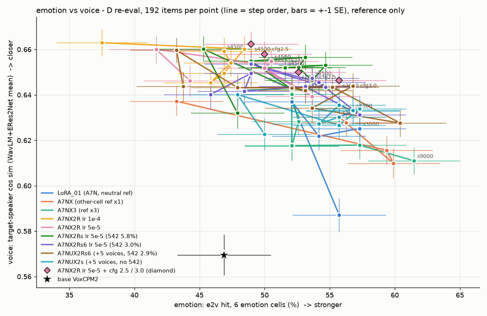
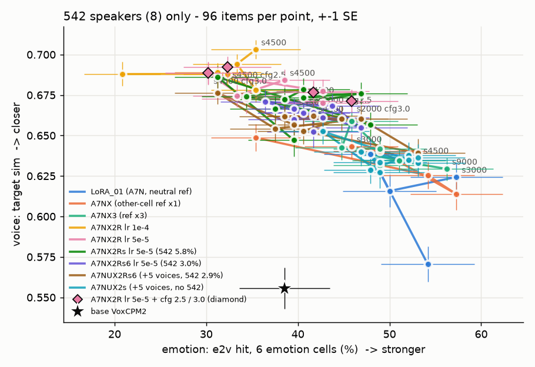
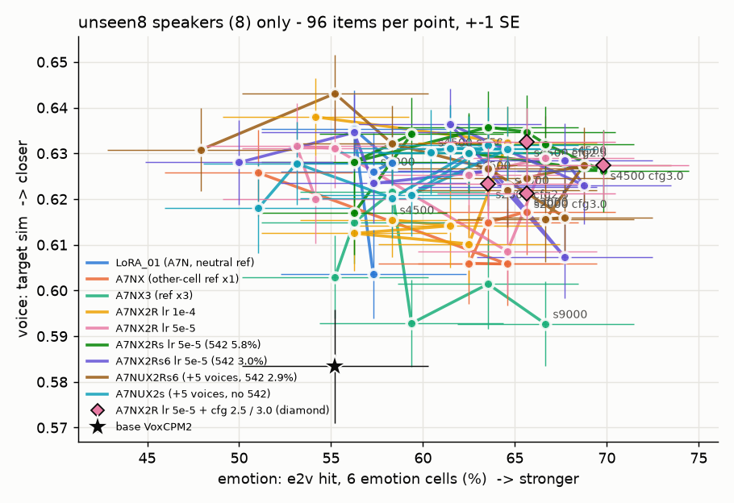

# A7NU 두 판 결과 — 새 5목소리는 효과 없음 · 542 를 빼면 542 화자 감정이 돌아옴

> 📅 2026-11-07 21:36 KST · 지시문: q3tts 세션 18:40(`_handoff/20261107_1840_prompt_a7nu_full.md`) §4-3
> 숫자는 모두 **참고용**이고, 판정은 청음으로 합니다. 이전 보고서: [20261107_A7NX2Rs_results.md](20261107_A7NX2Rs_results.md)

---

## 0. 한 줄 요약
- **새 5목소리 효과(A7NUX2Rs6 vs X2Rs6) → 거의 없음.**
  - 9 step 평균이 거의 같습니다.
    - 전체 e2v 6칸: 51.7% → 51.8%
    - 기쁨B: 24% → 23%
    - 542 A칸: 31.5% → 31.7%
    - unseen8 A칸: 61% → 63%
  - 목소리도 같은 수준입니다(1위 92.5% → 91.2% · 유사도 0.659 → 0.657).
- **542 있음/없음(A7NUX2s vs A7NUX2Rs6) → 542 를 빼면 542 화자 A칸 감정이 돌아옵니다.**
  - 542 A칸 e2v 9 step 평균: 32% → **42%**. LoRA01(42%) · A7NX3(42~44%) 와 같은 수준입니다.
  - 9 step 모두 35~50% 입니다(A7NUX2Rs6 은 19~46% · 평균 32%).
  - 대가가 있습니다.
    - 542 화자 목소리 유사도가 조금 내려갑니다(A칸 0.687 → 0.669).
    - unseen8 A칸 e2v 도 63% → 56% 로 내려갑니다(잡음 ±7%p 경계).
  - ⚠️ 542 를 빼면서 **무감정 비율도 10.7% → 8.05% 로 함께 줄었습니다.** 그래서 "542 행" 때문인지 "무감정 비율" 때문인지는 이 실험만으로 가를 수 없습니다.
- **목소리(1위 · 유사도)는 X2Rs6 수준을 거의 지켰습니다.**
  - A7NUX2Rs6 은 같습니다.
  - A7NUX2s 는 유사도가 0.01 낮습니다(0.647 · 1위 90%). LoRA01(0.654 · 93%) 보다 조금 낮은 정도입니다.
- 통합 참고 점수: A7NUX2Rs6 s3500 = 144 · A7NUX2s s4500 = 144(1위 X2Rs6 s4500 145 와 1점 차).
- 청음 추천: **A7NUX2s s4500 · A7NUX2Rs6 s3500**(D 재측정 페이지에 열로 넣었습니다). 542 화자 A칸을 X2Rs6 s4500 · LoRA01 s1500 과 비교해 주세요.

## 1. 무엇을 했나
| | A7NUX2Rs6 | A7NUX2s |
|---|---|---|
| run | `A7NUX2Rs6_xref_LoRA_01_r32_lr5e5` | `A7NUX2s_xref_LoRA_01_r32_lr5e5` |
| 데이터 | 206,570행 | 200,629행 |
| 542 | 5,941행(2.9%) | **0** |
| 무감정 비율 | 10.7% | **8.05%** |
| 학습(KST) | 18:44 ~ 19:35 | 19:35 ~ 20:26 |

- 비교 짝
  - **A7NX2Rs6 → A7NUX2Rs6**: 새 5목소리 9,274행만 더했습니다(A7N · 542 행은 똑같음).
  - **A7NUX2Rs6 → A7NUX2s**: 542 행만 뺐습니다(A7N · 새 5목소리 행은 똑같음).
- 설정: A7NX2Rs6 복제 · lr 5e-5 · r32 · 배치 32 · 4,500 step · seed 1986 · bf16 · GPU 2,3(Claude nohup · 사용자 승인 18:38).
- 설정 차이(A7NX2Rs6 대비): 아래 세 줄과 머리 주석뿐입니다.

```diff
-  run_name: A7NX2Rs6_xref_LoRA_01_r32_lr5e5
+  run_name: A7NUX2Rs6_xref_LoRA_01_r32_lr5e5        # A7NUX2s 는 A7NUX2s_…
-  train_jsonl: A7NX2Rs6/train.jsonl
+  train_jsonl: A7NUX2Rs6/train.jsonl               # A7NUX2s 는 A7NUX2s/train.jsonl
-  val_xref_jsonl: A7NX2Rs6/val_xref.jsonl
+  val_xref_jsonl: A7NUX2Rs6/val_xref.jsonl         # 내용(md5)은 A7NX2Rs6 과 같음
```

- byobu 로 다시 돌릴 때 같은 명령:
```bash
cd ~/workspaces/vox_koft && conda activate voxcpm && \
./scripts/run.sh train lora --exp configs/experiments/lora/A7NUX2Rs6_xref_LoRA_01_r32_lr5e5.yaml --hw rtxpro6000_2gpu --accel 2gpu_b && \
./scripts/run.sh train lora --exp configs/experiments/lora/A7NUX2s_xref_LoRA_01_r32_lr5e5.yaml --hw rtxpro6000_2gpu --accel 2gpu_b
```
- 완료 확인
  - 두 판 모두 `_COMPLETE` 9개이고 오류는 0입니다.
  - 재개용 파일은 step_4500 에만 있습니다. 정리는 사용자 승인 뒤에 합니다.
  - 학습 뒤 백업: `exp_reports/lora/<run>/run_backup/` · `curves.png`

### 새 5목소리 — 칸별 행 수
- 출처: `A7NUX2Rs6/dataset_info.json` counts.a7nu_by_speaker. 두 데이터에서 같습니다.
- 강도 2 를 B 로 두었습니다(이 5목소리는 강도 3 이 없음).

| 화자 | 말투 | 분노 | 기쁨 | 슬픔 | 무감정 |
|---|---|---|---|---|---|
| aihub_0006_ani | 애니(여아) | B 166 | B 686 | B 738 | 409 |
| aihub_0019_ani | 애니(남아) | A 532 | A 66 | B 744 | ref 만 |
| aihub_0030_ani | 애니(할머니) | A 646 | B 566 | B 370 | 217 |
| aihub_0036_ani | 애니(아줌마) | B 278 | A 652 | B 730 | ref 만 |
| aihub_0019 | 친절체 | A 186 ⚠️ | A 1,026 | A 694 | 568 |

- ⚠️ **0019 친절체 분노A(정답 93개 · 186행)는 상담 대본이라 분노가 약할 수 있습니다**(q3tts 세션 메모).
- "ref 만" = 무감정 녹음을 정답에서 빼고 ref 로만 씁니다(0019 애니 "딱딱함" · 0036 애니 "애매" 판정).
- 자세한 설명: [datasets/A7NX_vox_koft.md](../datasets/A7NX_vox_koft.md) A7NU 절.

## 2. TensorBoard (참고)
| run | val 최저 · s4500 | val_unseen 최저 · s4500 | val_xref s4500 | val_stop s4500 |
|---|---|---|---|---|
| X2Rs6 | 0.7922 · 0.7922 | s1000 0.8067 · 0.8086 | 0.7804 | 0.0107 |
| A7NUX2Rs6 | 0.7916 · 0.7916 | s3000 0.8072 · 0.8075 | 0.7809 | 0.0101 |
| A7NUX2s | 0.7909 · 0.7909 | s3000 0.8068 · 0.8072 | 0.7807 | 0.0091 |

- val_stop = val/loss_stop(끝맺음 loss).
- 세 판의 곡선은 거의 겹칩니다.
  - A7NU 두 판은 val_unseen 이 s1000 뒤에도 오르지 않고 평평합니다. X2Rs6 은 조금 올랐습니다.
  - A7NUX2s 는 val_stop 이 조금 낮습니다(0.0091).
- loss 로는 세 판을 가를 수 없습니다.

## 3. D 재측정 — 542 8명 vs unseen8 8명 (핵심 표)
- 대상: 두 run × 9 step. 칸마다 화자 8명 × 감정 3 × 문장 2 = 48개이고, ±7%p 는 잡음입니다.
- 전체 표(arousal · 유사도 · 1위 · CER · 이상 · 화자별): [figs/20261107_A7NU_group_split.md](figs/20261107_A7NU_group_split.md)

**e2v 감정 맞힘**
| 모델 | 542 A | 542 B | unseen8 A | unseen8 B |
|---|---|---|---|---|
| 원본 | 27% | 50% | 46% | 65% |
| LoRA01 s1500 | 42% | 54% | 52% | 60% |
| A7NX3 s2250 | 44% | 48% | 54% | 62% |
| A7NX3 s4500 | 42% | 60% | 62% | 65% |
| X2R02 s4500 | 19% | 58% | 60% | 65% |
| X2Rs6 s4500 | 29% | 50% | 67% | 69% |
| NUX2Rs6 s2500 | 46% | 60% | 65% | 71% |
| NUX2Rs6 s3500 | 38% | 52% | 71% | 67% |
| NUX2Rs6 s4500 | 33% | 50% | 65% | 65% |
| NUX2s s2000 | 50% | 54% | 67% | 58% |
| NUX2s s4000 | 42% | 62% | 54% | 69% |
| NUX2s s4500 | 48% | 58% | 54% | 67% |
| **X2Rs6 9 step 평균** | 31% | 51% | 61% | 63% |
| **NUX2Rs6 9 step 평균** | 32% | 51% | 63% | 61% |
| **NUX2s 9 step 평균** | **42%** | 57% | 56% | 63% |

**9 step 평균 — 목소리 · arousal**
| 모델 | 542 A 유사도 · 1위 · arousal | unseen8 A 유사도 · 1위 · arousal |
|---|---|---|
| LoRA01 s1500(한 점) | 0.678 · 99% · 0.502 | 0.659 · 97% · 0.541 |
| X2Rs6 | 0.691 · 96% · 0.449 | 0.644 · 93% · 0.535 |
| NUX2Rs6 | 0.687 · 94% · 0.450 | 0.647 · 93% · 0.538 |
| NUX2s | 0.669 · 93% · 0.474 | 0.647 · 93% · 0.519 |

### 물음 1 — 새 5목소리 효과(A7NUX2Rs6 vs X2Rs6)
- **거의 없습니다.** 9 step 평균을 같은 잣대로 보면 모든 값이 잡음 범위 안입니다.

| 값(9 step 평균) | X2Rs6 | A7NUX2Rs6 |
|---|---|---|
| 전체 e2v 6칸 | 51.7% | 51.8% |
| 기쁨B(16명) | 24.0% | 22.9% |
| 542 A | 31.5% | 31.7% |
| unseen8 A | 60.9% | 63.0% |
| 1위(두 잣대) | 92.5% | 91.2% |
| 유사도 | 0.659 | 0.657 |

- 새 5목소리 9,274행은 전체의 4.5% 입니다. 기쁨B 를 겨냥한 행(0006 애니 B 686 · 0030 애니 B 566)도 기쁨B 를 올리지 못했습니다(19~25%).
- 이상(끝 잘림 등)은 542 칸에서 조금 늘었습니다(542 A 0~10% · X2Rs6 s4500 2%). 잡음일 수 있습니다.

### 물음 2 — 542 있음/없음(A7NUX2s vs A7NUX2Rs6)
- **542 A칸 e2v 가 LoRA01 · A7NX3 수준으로 돌아왔습니다.**
  - 9 step 평균 32% → 42% (+10%p). 칸마다 48개라 한 점끼리는 ±7%p 가 잡음이지만, 9 step 평균 차이라 우연일 가능성은 낮습니다.
  - arousal 도 0.450 → 0.474 로 LoRA01(0.502) 쪽으로 움직였습니다.
  - 화자별: a542_0270 이 2~3 → 8~9(12개 중)로 크게 올랐습니다. a542_1099 는 여전히 0~2 입니다.
- **대가**
  - 542 화자 목소리 유사도가 0.687 → 0.669 로 내려갑니다(1위 94% → 93%). 감정 ↔ 목소리 맞바꿈 곡선을 따라 움직인 모양입니다(§6 그림).
  - unseen8 A칸 e2v 는 63% → 56% 입니다(−7%p · 경계).
  - 전체(16명) e2v 6칸은 51.8% → 54.5% 로 오릅니다.
- ⚠️ **해석 주의**: 542 를 빼면 무감정 비율도 10.7% → 8.05% 로 줄었습니다. 그래서 다음 둘을 가를 수 없습니다.
  - "낭독 목소리 ref → 늘 무감정 정답"(542 지름길)이 원인
  - 그냥 무감정 비율이 줄어서 감정이 세진 것
  - A7NX2Rs(5.8%) vs Rs6(3.0%) 에서는 542 를 절반으로 줄여도 거의 변화가 없었습니다(28% → 31%). 그런데 0 으로 만들자 크게 바뀌었습니다. 그래서 **"542 가 조금이라도 있으면 지름길이 생긴다"** 쪽과 맞아 보입니다(추정).

### 물음 3 — 목소리가 X2Rs6 수준으로 남았나
- A7NUX2Rs6: **예**(유사도 0.657 · 1위 91% · X2Rs6 0.659 · 93%).
- A7NUX2s: **거의**(0.647 · 90%). X2Rs6 보다 0.01 낮고, 542 화자 쪽에서 내려갔습니다.
- 센 감정 칸(B평균) 목소리: X2Rs6 s4500 0.674 · NUX2Rs6 s4500 0.662 · NUX2s s4500 0.652 · LoRA01 0.646(§5).

## 4. D 재측정 — 16명 전체 · best 5
**한눈에(7칸 · 1위와 유사도는 두 잣대 평균)**
| 모델 | 점수 | e2v 6칸 | 1위 | 유사도 | CER | 이상 | 기쁨B | 중립 |
|---|---|---|---|---|---|---|---|---|
| 원본 | 104 | 47% | 75% | 0.593 | 4.9% | 14% | 50% | 56% |
| LoRA01 s1500 | 142 | 52% | 93% | 0.654 | 2.2% | 2% | 9% | 59% |
| A7NX3 s4500 | 144 | 57% | 87% | 0.631 | 2.2% | 3% | 41% | 88% |
| X2R02 s4500 | 143 | 51% | 95% | 0.668 | 1.5% | 1% | 28% | 50% |
| X2Rs6 s4500 | **145** | 54% | 94% | 0.661 | 1.7% | 3% | 22% | 69% |
| NUX2Rs6 s2500 | 143 | 60% | 90% | 0.645 | 2.1% | 5% | 19% | 62% |
| NUX2Rs6 s3500 | 144 | 57% | 92% | 0.658 | 1.9% | 4% | 25% | 62% |
| NUX2s s4000 | 143 | 57% | 91% | 0.648 | 1.8% | 3% | 22% | 53% |
| NUX2s s4500 | 144 | 57% | 92% | 0.649 | 1.9% | 2% | 22% | 53% |

- **best 5(참고 점수 순 · 청음 노트북 셀 2)**
  - A7NUX2Rs6: 3500 · 2500 · 4500 · 2000 · 4000
  - A7NUX2s: 4500 · 4000 · 3000 · 3500 · 1500
- 성공 기준 · 칸별 표: `~/workspaces/tmp_listen/vox_koft/d_eval/tables.md`
- 기쁨B 는 두 판 모두 16~31% 로 여전히 약합니다. A7NX3 s4500(41%) 만 높습니다.
- A7NUX2s 는 step 이 지나도 고릅니다(s1500 뒤 점수 140~144). A7NUX2Rs6 은 step 마다 더 흔들립니다(137~144).

## 5. 칸별 목소리 이동 · 감정 ref 판
- 칸별 목소리(생성 중립 대비 유사도 · B평균): X2Rs6 s4500 0.674 · NUX2Rs6 s4500 0.662 · s3500 0.668 · NUX2s s4500 0.652 · LoRA01 0.646
  - 새 두 판은 센 감정 칸에서 목소리가 조금 더 움직입니다(감정이 세진 만큼). 그래도 LoRA01 보다는 덜 움직입니다.
  - 표: [figs/20261107_A7NU_cell_drift.md](figs/20261107_A7NU_cell_drift.md)
- 감정 ref 판(각 s4500 · 224개 · `d_eval_eref/tables.md`)

| 모델 | 지시문 감정 e2v | ref 감정 샘 | 중립 칸 중립 | 자기 중립 유사도 |
|---|---|---|---|---|
| LoRA01 s1500 | 44% | 28% | 3% | 0.596 |
| X2Rs6 s4500 | 52% | 21% | 6% | 0.598 |
| NUX2Rs6 s4500 | 53% | 22% | 3% | 0.596 |
| NUX2s s4500 | 53% | 19% | 12% | **0.611** |

  - 감정 ref 를 줘도 지시문을 따르는 정도는 X2Rs6 과 같습니다.
  - A7NUX2s 는 ref 감정이 덜 새고(19%), 자기 목소리를 가장 잘 지킵니다(0.611). 다만 잡음 범위에 가깝습니다.

## 6. 감정 ↔ 목소리 그림


| 542 8명 | unseen8 8명 |
|---|---|
|  |  |

- 갈색 = A7NUX2Rs6, 청록 = A7NUX2s.
- 542 그림
  - 갈색은 X2R 무리(왼쪽 위)에 그대로 있습니다.
  - 청록은 오른쪽 아래로 옮겨 LoRA01 · A7NX3 무리와 섞입니다. 감정 ↑ · 목소리 ↓ 입니다. 맞바꿈 곡선을 넘은 것이 아니라 **곡선 위에서 자리만 옮긴** 모양입니다.
- unseen8 그림: 두 판 모두 X2Rs6 근처(오른쪽 위)입니다.
- 숫자: [figs/20261107_emo_voice.md](figs/20261107_emo_voice.md) · `_542.md` · `_unseen8.md`
- 점이 많아 전체 그림은 글씨가 겹칩니다. 묶음별 작은 그림이 읽기 쉽습니다.

## 7. 청음
- D 재측정: http://127.0.0.1:8765/vox_koft/d_eval/index.html
  - 새 열 **NUX2Rs6lr5e5_s3500 · NUX2slr5e5_s4500**(각 224개)
- 감정 ref 판: http://127.0.0.1:8765/vox_koft/d_eval_eref/index.html — 새 열 NUX2Rs6lr5e5_s4500 · NUX2slr5e5_s4500
- 재현: 노트북 엔진(`voxko.listen.Listener`)으로 4개를 다시 만들었고 **4/4 같은 소리**입니다(감정 ref 판 2 · D 재측정 2).
- 바꾸기 전 백업: `d_eval/_backup_20261107_2125_before_a7nu/` · `d_eval_eref/_backup_20261107_2125_before_a7nu/`
- 판정 칸: D 재측정 4,992 → 5,888 · 감정 ref 판 48 → 64. 이전 판정 id 는 하나도 빠지지 않았습니다.
- 판정 버튼 id 와 저장 키는 바꾸지 않았습니다.
- 청음 노트북(GPU **1** · smoke 실행 확인)
  - `notebooks/lora/A7NUX2Rs6_xref_LoRA_01_r32_lr5e5_listening.ipynb`
  - `notebooks/lora/A7NUX2s_xref_LoRA_01_r32_lr5e5_listening.ipynb`

## 8. 다음 (사용자 결정)
- 청음: A7NUX2s s4500 의 **542 화자 A칸**이 X2Rs6 s4500 보다 감정이 살아 있는지, 목소리가 덜 닮게 들리는지 들어 주세요. LoRA01 s1500 · A7NX3 s4500 과도 비교해 주세요.
- 542 지름길 vs 무감정 비율: 가르려면 **542 0 + 무감정 비율 10.7% 로 맞춘 판**(A7N 무감정 행을 더 넣음)이 필요합니다(제안 · 결정은 사용자).
- 새 5목소리는 숫자로는 효과가 없었습니다. 다음 판에 계속 넣을지는 청음 뒤 결정해 주세요.
- 재개용 파일 정리(두 run step_4500)는 승인 뒤에 합니다.
