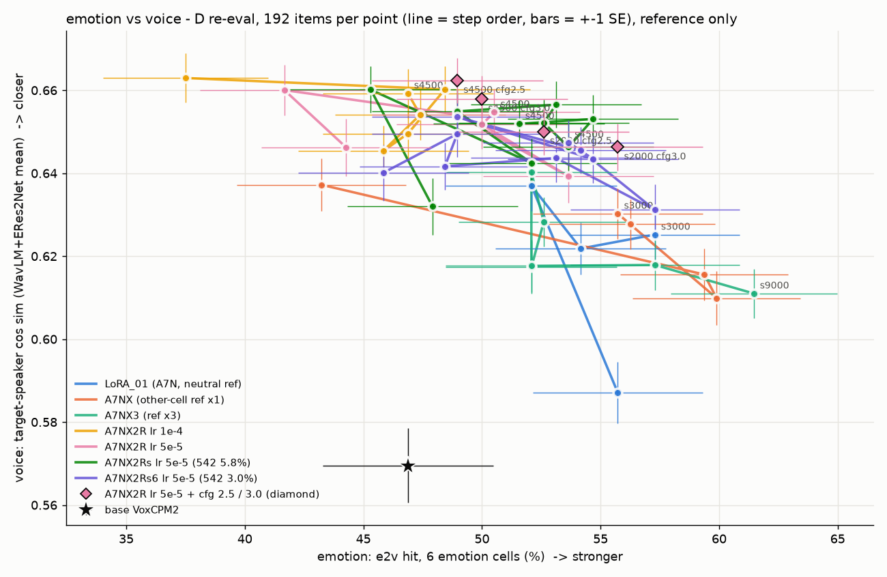
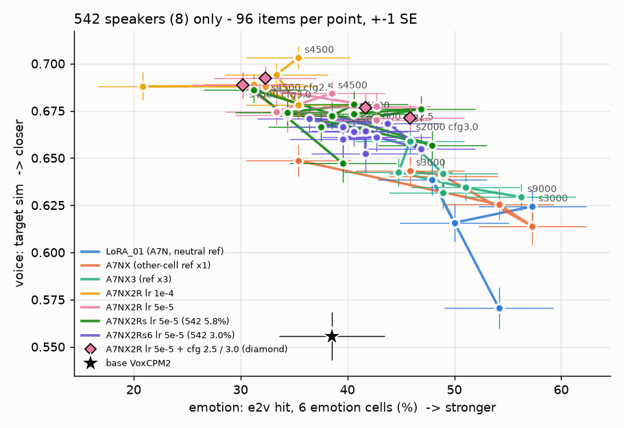
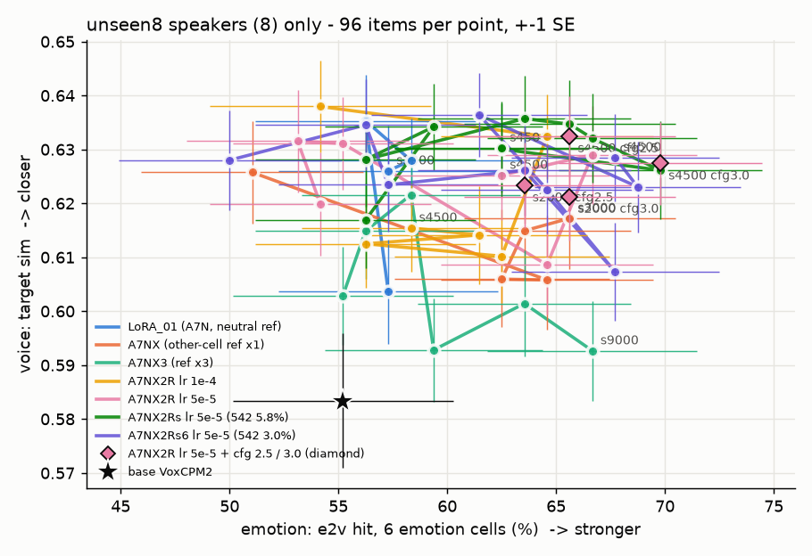

# A7NX2Rs · A7NX2Rs6 결과 — 542 를 줄여도 542 화자 감정은 돌아오지 않음

> 📅 2026-11-07 18:50 KST · 지시문: q3tts 세션 15:30(`_handoff/20261107_1530_prompt_a7nx2rs_x2_full.md`) §6
> 숫자는 모두 **참고용**이고, 판정은 청음으로 합니다. 이전 보고서: [20261107_A7NX2R_results.md](20261107_A7NX2R_results.md) · [20261107_cfg_test_emo_voice.md](20261107_cfg_test_emo_voice.md)

---

## 0. 한 줄 요약
- **542 화자 A칸 감정(e2v)은 돌아오지 않았습니다.**
  - X2R02 s4500 은 19% 였습니다. 두 새 판은 Rs 17~35%, Rs6 27~38% 입니다.
  - LoRA01(42%) · A7NX3(42~44%) 수준에는 못 미칩니다.
- **542 를 절반으로 줄인 Rs6 이 542 A칸에서 조금 높습니다.**
  - 9개 step 평균이 Rs 28% → Rs6 31% 입니다.
  - 하지만 칸마다 48개라 ±7%p 가 잡음입니다. "542 지름길" 가설을 확인했다고 하기 어렵습니다.
  - Rs6 은 무감정 비율도 함께 줄었습니다(13.2% → 10.6%). 그래서 542 만의 효과라고 가를 수 없습니다.
- **unseen8(감정 녹음이 있는 처음 보는 화자) 쪽 이득은 남았습니다.**
  - A칸 e2v: Rs 58~79% · Rs6 52~69% (LoRA01 52% · 원본 46%)
- **전체(16명)로 보면 지금까지 가장 고른 판입니다.** 통합 참고 점수 1위는 X2Rs6 s4500(145)입니다. 목소리는 X2R02 수준으로 유지하면서 감정 6칸이 51% → 54~55% 로 조금 올랐습니다.
  - 다만 차이는 대부분 1 표준오차 안입니다.
- 청음 추천: **X2Rs6 s4500 · X2Rs01 s4000**(D 재측정 페이지에 열로 넣었습니다).

## 1. 무엇을 했나
| | A7NX2Rs | A7NX2Rs6 |
|---|---|---|
| run | `A7NX2Rs_xref_LoRA_01_r32_lr5e5` | `A7NX2Rs6_xref_LoRA_01_r32_lr5e5` |
| 데이터 | 203,110행 | 197,296행 |
| 542 비율 | 5.8%(화자당 12) | **3.0%**(화자당 6) |
| 무감정 비율 | 13.2% | **10.6%** |
| 학습(KST) | 15:38 ~ 16:27 | 16:28 ~ 17:17 |

- 두 판의 차이는 데이터 경로뿐입니다.
  - A7N 행은 완전히 같습니다.
  - Rs6 의 542 행은 Rs 542 행의 부분집합입니다.
- 설정: lr 5e-5 · r32 · 배치 32 · 4,500 step · seed 1986 · bf16 · GPU 2,3(Claude nohup · 사용자 승인 15:15).
- ⚠️ 542 는 전부 무감정 정답입니다. 그래서 542 를 줄이면 **무감정 비율도 함께 줄어듭니다.**
- 완료 확인
  - 두 판 모두 `_COMPLETE` 9개 · 오류 0 · export 실패 0입니다.
  - 재개용 파일은 step_4500 에만 있습니다. 정리는 사용자 승인 뒤에 합니다.
  - 학습 뒤 백업: `exp_reports/lora/<run>/run_backup/` · `curves.png`

## 2. TensorBoard (참고)
| run | val_unseen 최저 | s4500 val_unseen | s4500 val_xref |
|---|---|---|---|
| X2R02(lr 5e-5) | s1000 0.8076 | 0.8082 | 0.7806 |
| X2Rs01 | s1000 0.8076 | 0.8092 | 0.7806 |
| X2Rs6 | s1000 0.8067 | 0.8086 | 0.7804 |

- 세 판의 곡선 모양이 거의 같습니다.
  - val_unseen 은 s1000 뒤 아주 조금 오릅니다.
  - val_xref 는 끝까지 내려갑니다.
- loss 로는 세 판을 가를 수 없습니다.

## 3. D 재측정 — 542 8명 vs unseen8 8명 (핵심 표)
- 대상: 두 run × 9 step. 칸마다 화자 8명 × 감정 3 × 문장 2 = 48개이고, ±7%p 는 잡음입니다.
- 전체 표(arousal · 유사도 · 1위 · CER · 이상 · 화자별): [figs/20261107_A7NX2Rs_group_split.md](figs/20261107_A7NX2Rs_group_split.md) · 도구 `tools/group_split.py`

**e2v 감정 맞힘**
| 모델 | 542 A | 542 B | unseen8 A | unseen8 B |
|---|---|---|---|---|
| 원본 | 27% | 50% | 46% | 65% |
| LoRA01 s1500 | 42% | 54% | 52% | 60% |
| A7NX3 s2250 | 44% | 48% | 54% | 62% |
| A7NX3 s4500 | 42% | 60% | 62% | 65% |
| X2R02 s2000 | 29% | 56% | 65% | 65% |
| X2R02 s4500 | 19% | 58% | 60% | 65% |
| X2Rs01 s2500 | 31% | 50% | 67% | 65% |
| X2Rs01 s4000 | 31% | 62% | 58% | 67% |
| X2Rs01 s4500 | 25% | 56% | 65% | 60% |
| X2Rs6 s2500 | 38% | 56% | 69% | 67% |
| X2Rs6 s4000 | 27% | 54% | 65% | 73% |
| X2Rs6 s4500 | 29% | 50% | 67% | 69% |
| X2Rs01 9 step 평균 | 28% | 52% | 65% | 60% |
| X2Rs6 9 step 평균 | 31% | 51% | 61% | 63% |

**목표 유사도 · 1위(542 A · unseen8 A 만)**
| 모델 | 542 A 유사도 · 1위 | unseen8 A 유사도 · 1위 |
|---|---|---|
| LoRA01 s1500 | 0.678 · 99% | 0.659 · 97% |
| A7NX3 s2250 | 0.672 · 97% | 0.632 · 90% |
| X2R02 s4500 | 0.707 · 99% | 0.648 · 96% |
| X2Rs01 s4500 | 0.698 · 94% | 0.652 · 98% |
| X2Rs6 s4500 | 0.698 · 95% | 0.655 · 95% |

### 물음에 대한 답
1. **542 A칸 e2v 가 19% → 42% 근처로 돌아왔나 → 아니요.**
   - 가장 높은 값은 X2Rs6 s2500 38% 이고, 나머지 step 은 25~35% 입니다.
   - arousal 도 542 A칸 0.43~0.46 으로 X2R02(0.43~0.45) 와 같고, LoRA01(0.50) 보다 낮습니다.
2. **Rs6 이 Rs 보다 나은가(542 지름길 가설) → 조금 낫지만 잡음 안입니다.**
   - 542 A 9 step 평균: Rs 28% · Rs6 31%(+3.6%p)
   - 542 를 절반으로 줄였는데도 LoRA01 과의 차이(약 −11%p)가 대부분 남았습니다.
   - 그래서 "542 행 양"보다는 **"다른 칸 ref 2개(A7NX2R 계열) 구성 자체"** 쪽이 더 의심스럽습니다. 같은 lr · step 의 A7NX3 는 542 A칸 42~44% 입니다.
   - 단, 이것은 숫자로 본 추정입니다.
3. **unseen8 이득이 남았나 → 예.**
   - unseen8 A칸: Rs 평균 65% · Rs6 평균 61% 입니다. LoRA01 52% 보다 높고, X2R02(60~65%)와 같은 수준입니다.

### 부록 — 화자별(감정 6칸 × 2 = 12개 중 e2v 맞힘)
- 542 화자 가운데 **a542_1099** 와 **a542_0270** 이 특히 낮습니다.
  - a542_1099: X2R 계열 0~3 · A7NX3 1~3 · 원본과 LoRA01 은 4
  - a542_0270: X2R 계열 2~6 · 원본 · LoRA01 · A7NX3 은 6
- 모든 모델 · 화자 값은 [figs/20261107_A7NX2Rs_group_split.md](figs/20261107_A7NX2Rs_group_split.md) 부록에 있습니다.

## 4. D 재측정 — 16명 전체 · best 5
**한눈에(7칸 · 1위와 유사도는 두 잣대 평균)**
| 모델 | 점수 | e2v 6칸 | 1위 | 유사도 | CER | 이상 | 기쁨B | 중립 |
|---|---|---|---|---|---|---|---|---|
| 원본 | 104 | 47% | 75% | 0.593 | 4.9% | 14% | 50% | 56% |
| LoRA01 s1500 | 142 | 52% | 93% | 0.654 | 2.2% | 2% | 9% | 59% |
| A7NX3 s4500 | 144 | 57% | 87% | 0.631 | 2.2% | 3% | 41% | 88% |
| X2R02 s4500 | 143 | 51% | 95% | 0.668 | 1.5% | 1% | 28% | 50% |
| X2Rs01 s4000 | 144 | 55% | 94% | 0.667 | 1.8% | 4% | 28% | 59% |
| X2Rs6 s2500 | 144 | 57% | 91% | 0.647 | 2.1% | 3% | 19% | 62% |
| X2Rs6 s4500 | **145** | 54% | 94% | 0.661 | 1.7% | 3% | 22% | 69% |

- 통합 상위 5: X2Rs6 s4500 · X2Rs6 s2500 · A7NX3 s4500 · X2Rs01 s4000 · A7NX3 s2250. 점수 차는 1~2점뿐입니다.
- 성공 기준 · 칸별 표: `~/workspaces/tmp_listen/vox_koft/d_eval/tables.md`
- **best 5(참고 점수 순 · 청음 노트북 셀 2)**
  - A7NX2Rs: 4000 · 2500 · 3500 · 3000 · 2000
  - A7NX2Rs6: 4500 · 2500 · 4000 · 3000 · 2000
- 이상(끝 잘림 · 긴 무음 등)은 3~5% 입니다. X2R02 보다 1~2%p 높지만 잡음 범위입니다.
- 기쁨B 는 여전히 약합니다(19~28%). A7NX3 s4500(41%)과의 차이가 큽니다.

## 5. 칸별 목소리 이동 · 감정 ref 판
- 칸별 목소리(목표 유사도 · B평균): X2Rs01 0.675~0.676 · X2Rs6 s4500 0.674 · X2R02 0.681 · LoRA01 0.646
  - 센 감정 칸에서도 목소리를 지키는 힘은 X2R02 와 거의 같습니다.
  - 표: [figs/20261107_A7NX2Rs_cell_drift.md](figs/20261107_A7NX2Rs_cell_drift.md)
- 감정 ref 판(각 s4500 · 224개 · `d_eval_eref/tables.md`)

| 모델 | 지시문 감정 e2v | ref 감정 샘 | 중립 칸 중립 |
|---|---|---|---|
| LoRA01 s1500 | 44% | 28% | 3% |
| X2R02 s4500 | 47% | 24% | 16% |
| X2Rs01 s4500 | 50% | 23% | 12% |
| X2Rs6 s4500 | 52% | 21% | 6% |

  - 감정 ref 를 줘도 지시문을 따르는 정도는 X2R 계열 가운데 가장 낫습니다. 다만 잡음 범위 안입니다.

## 6. 감정 ↔ 목소리 그림

| 542 8명 | unseen8 8명 |
|---|---|
|  |  |

- 점 하나는 한 모델(run · step)입니다.
  - x = e2v(감정 6칸), y = 목표 유사도
  - 전체 그림은 점마다 192개, 묶음 그림은 96개입니다.
- 초록(Rs) · 보라(Rs6) 는 분홍(X2R02) 보다 **조금 오른쪽**에 있습니다. 예: Rs01 s4000 54.7% · 0.653, Rs6 s4500 53.6% · 0.647, X2R02 s4500 50.5% · 0.655.
  - 목소리 쪽에서 감정 쪽으로 돌아왔지만 1 표준오차 정도입니다.
- 542 그림에서는 새 두 판도 X2R 무리(왼쪽 위)에 그대로 있습니다. LoRA01 · A7NX3 처럼 오른쪽으로 가지 못했습니다.
- unseen8 그림에서는 새 두 판이 오른쪽 위(감정 ↑ · 목소리 ↑)에 있습니다.
- 숫자: [figs/20261107_emo_voice.md](figs/20261107_emo_voice.md) · `_542.md` · `_unseen8.md`
- 그림 글씨는 영어입니다(서버 voxcpm env 에 한글 폰트가 없음).

## 7. 청음
- D 재측정: http://127.0.0.1:8765/vox_koft/d_eval/index.html
  - 새 열 **X2Rs01lr5e5_s4000 · X2Rs6lr5e5_s4500**(각 224개)
  - unseen8 표에는 진짜 사람 녹음 열이 있습니다(비교용 · 말투 · 문장 다름).
- 감정 ref 판: http://127.0.0.1:8765/vox_koft/d_eval_eref/index.html — 새 열 X2Rs01lr5e5_s4500 · X2Rs6lr5e5_s4500
- 재현: 노트북 엔진(`voxko.listen.Listener`)으로 4개를 다시 만들었고 **4/4 같은 소리**입니다(감정 ref 판 2 · D 재측정 2).
- 판정 버튼 id 와 저장 키는 바꾸지 않았습니다. 지금까지 남긴 판정은 그대로 보입니다(빠진 id 0).
- 바꾸기 전 백업: `d_eval/_backup_20261107_1815_before_x2rs/` · `d_eval_eref/_backup_20261107_1830_before_x2rs/`
- 청음 노트북
  - `notebooks/lora/A7NX2Rs_xref_LoRA_01_r32_lr5e5_listening.ipynb`
  - `notebooks/lora/A7NX2Rs6_xref_LoRA_01_r32_lr5e5_listening.ipynb`
  - GPU 는 **1** 로 맞춰 두었습니다(첫 셀 `CUDA_VISIBLE_DEVICES`).
  - smoke 실행으로 확인했습니다.

## 8. 다음 (사용자 결정)
- 청음으로 X2Rs6 s4500 · X2Rs01 s4000 을 X2R02 s4500 · A7NX3 s4500 · LoRA01 s1500 과 비교해 주세요. 특히 542 화자 A칸과 기쁨B 를 봐 주세요.
- 542 A칸이 숫자대로 약하게 들린다면, 다음 판은 542 양보다 **ref 구성(A7NX3 처럼 다른 칸 ref 3개 · 또는 542 행 ref 를 감정 녹음 화자에서 고르기)** 쪽을 바꾸는 편이 맞아 보입니다(추정).
- 재개용 파일 정리(두 run step_4500)는 승인 뒤에 합니다.
