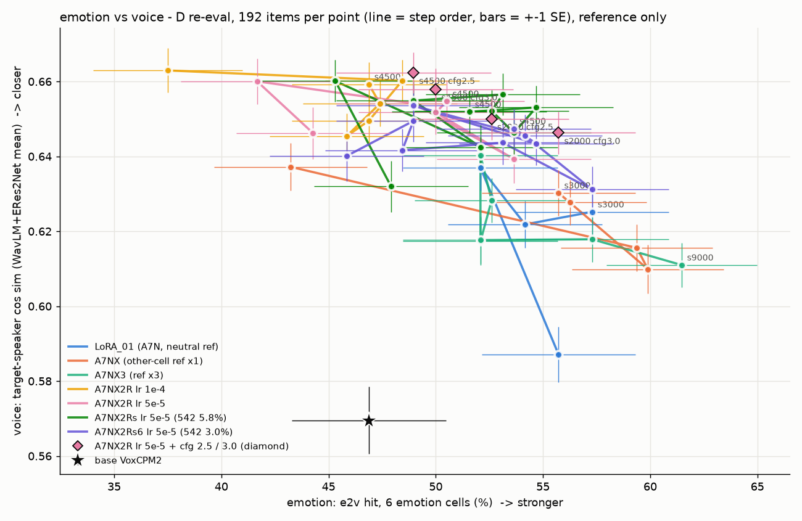

# CFG 시험 · 감정 ↔ 목소리 그림 · 감정 ref 판 청음 페이지

> 📅 2026-11-07 12:15 KST · 지시문: q3tts 세션 11:45(`_handoff/20261107_1145_prompt_x2r_cleanup_cfg_a7nx2rs.md`) §4 · §5
> 숫자는 모두 **참고용**이고, 판정은 청음으로 합니다.
> 이어지는 보고서: [20261107_A7NX2R_results.md](20261107_A7NX2R_results.md) · 다음: [20261107_A7NX2Rs_results.md](20261107_A7NX2Rs_results.md)
> 🆕 18:50 보완(지시문 `_handoff/20261107_1650_prompt_cfg_eref_listening.md`): §1-5 사용자 청음 · 문장별 목소리 하락 · §3 사용자 판정 · 결론을 **cfg 2.0 유지**로 고침

---

## 0. 한 줄 요약
- **결론: CFG 는 감정을 올리지 못하고, 일부 문장의 목소리를 무너뜨립니다 → cfg 2.0 유지(추론 기본값 그대로).**
- CFG 를 2.0 → 2.5 · 3.0 으로 올려도 감정(e2v · arousal)은 잡음 범위 안에서만 움직입니다.
- 목소리 1위는 224개 평균으로 2~6%p 오릅니다.
  - 하지만 **문장마다 보면 오르는 문장과 크게 떨어지는 문장이 함께 늘어납니다**(§1-5).
  - 사용자 청음 "중간중간 목소리가 달라지는 것 같다"와 맞습니다.
- cfg 3.0 에서는 이상(끝 잘림 · 긴 무음 등)도 늘어납니다(s2000 2% → 8%).
- **감정 ↔ 목소리 그림:** A7NX2R 두 판은 맞바꿈 곡선을 확실히 넘었다기보다 **곡선을 따라 목소리 쪽으로 옮겨 간 모양**입니다. X2R02 s3000 · s4500 과 cfg 2.5 · 3.0 점이 곡선보다 조금 위에 있지만, 차이가 약 1~2 표준오차라 단정할 수 없습니다.

## 1. CFG 시험

### 1-1. CFG 가 지시문에도 걸리는가 (코드 근거)
- `VoxCPM/src/voxcpm/modules/locdit/unified_cfm.py` `solve_euler` 를 보면 두 쪽을 함께 계산합니다.
  - 조건 쪽은 `mu` 입니다. `mu` 는 LM 출력(은닉)이고, 문장 · 지시문 · reference 를 모두 본 결과입니다.
  - 무조건 쪽은 `mu` 를 0 으로 둡니다. 직전 소리 조각(`cond`)은 양쪽이 같습니다.
- 결과는 `무조건 + cfg × (조건 − 무조건)` 입니다.
- 즉 cfg 는 **지시문만 따로가 아니라 LM 조건 전체(문장 · 지시문 · 목소리)를 함께** 세게 합니다. 지시문에도 걸리기는 하지만 간접적입니다.
- 지난 노브 시험(LoRA01_s1500 · 4명 · [20261106_bestofn_voice_filter.md](20261106_bestofn_voice_filter.md))에서 cfg 2.5 가 e2v +10%p 를 보였습니다. 그래서 묻지 않고 진행했습니다.

### 1-2. 방법
- 모델: `A7NX2R_xref_LoRA_02_r32_lr5e5` 의 s2000 · s4500
- cfg: 2.0(기준) · 2.5 · 3.0
- 입력은 D 재측정과 똑같습니다.
  - 목표 16명 × 7칸 × 문장 2 = 224
  - 무감정 reference · seed 1986 · timesteps 10 · 준비 합성 뒤
- cfg 2.0 은 D 재측정 wav 를 그대로 썼습니다. 같은 코드 경로로 1개를 다시 만들어 같은 소리인 것을 확인했습니다.
- 채점은 d_eval 함수를 그대로 썼습니다: 두 잣대 목표 1위 · e2v · arousal · whisper CER · SQUIM 이상.
- 도구: `tools/cfg_test.py`. 결과 폴더: `~/workspaces/tmp_listen/vox_koft/cfg_test/`. 생성 재현은 4/4 true 입니다.

### 1-3. 결과 (6칸 = 감정 칸만 · 한 칸 32개 · e2v ±3.6%p 는 잡음)

| step · cfg | e2v 6칸 | arousal | 1위(두 잣대) | CER | 이상 |
|---|---|---|---|---|---|
| s2000 · 2.0 | 54% | 0.584 | 90% | 1.9% | 2% |
| s2000 · 2.5 | 53% | 0.582 | 94% | 1.9% | 5% |
| s2000 · 3.0 | 56% | 0.587 | 96% | 1.7% | 8% |
| s4500 · 2.0 | 51% | 0.560 | 94% | 1.5% | 1% |
| s4500 · 2.5 | 49% | 0.567 | 97% | 1.7% | 3% |
| s4500 · 3.0 | 50% | 0.570 | 96% | 1.8% | 4% |

- 칸별(e2v · arousal)은 `cfg_test/tables.md` 에 있습니다. 기쁨B 는 cfg 를 올려도 19~34% 로 낮고, 분노B 는 81~91% 로 높게 그대로입니다.
- **해석:**
  - 감정은 cfg 로 거의 올라가지 않습니다. arousal 은 +0.01 안팎입니다.
  - 목소리 1위는 2~6%p 오릅니다.
  - LoRA01 노브 시험의 +10%p(4명 · 32개)는 표본이 작아서 생긴 흔들림이었을 가능성이 큽니다.

### 1-4. 청음 페이지
- 주소: http://127.0.0.1:8765/vox_koft/cfg_test/index.html
- 구성: 기쁨B · 분노A · 분노B · 슬픔B × 처음 보는 화자 2명(여 aihub_0028 · 남 aihub_0012) × s2000 · s4500 × cfg 3개 = 48개 소리
- 판정 버튼(소리마다): 감정 약함 · OK · 과함 / 목소리 · 음질 좋음 · 거칢. 판정은 CSV 로 받습니다.
- 재현: 청음 노트북 엔진(`voxko.listen.Listener(cfg_value=…)`)으로 3개를 다시 만들었고 **3/3 같은 소리**입니다. cfg 2.0 칸은 D 재측정 wav 입니다.

### 1-5. 🆕 사용자 청음 · 문장별 목소리 하락 (11/07 16:50 보완)
- 사용자 청음 메모: **"중간중간 목소리가 달라지는 것 같다."**
- 방법
  - 같은 문장의 cfg 2.0(D 재측정 wav)과 cfg 2.5 · 3.0 을 짝지어 비교했습니다.
  - 잣대는 WavLM 목표 유사도 `t_sim` 과 목표 1위입니다.
  - 기준: 0.04 넘게 떨어짐, 또는 목표 화자가 1위가 아님
  - 파일: `cfg_test/sv_X2R02_s*_cfg*.json` ↔ `d_eval/sv_X2R02lr5e5_s{2000,4500}.json`
- 청음 페이지 64개(2명 × 4칸 × 문장 2 × step 2 × cfg 2.5 · 3.0) 가운데 **13개**가 해당합니다. 그중 3개는 1위가 아닙니다.

| step · cfg | 떨어진 것(cfg 2.0 → cfg) |
|---|---|
| s2000 · 2.5 | aihub_0028 기쁨B_1 0.556 → 0.508(1위 아님) · 슬픔B_0 0.595 → 0.548 |
| s2000 · 3.0 | aihub_0028 기쁨B_1 0.556 → 0.473(1위 아님) · 분노B_0 0.737 → 0.688 · 슬픔B_0 0.595 → 0.543 |
| s4500 · 2.5 | aihub_0028 기쁨B_1 0.691 → 0.569 · 슬픔B_1 0.613 → 0.530(1위 아님) · aihub_0012 분노B_0 0.638 → 0.563 |
| s4500 · 3.0 | aihub_0028 분노A_0 0.771 → 0.712 · 분노A_1 0.674 → 0.596 · 슬픔B_1 0.613 → 0.519(1위 아님) · aihub_0012 분노A_0 0.607 → 0.543 · 분노B_0 0.638 → 0.554 |

- 224개 전체(같은 기준 · 문장 짝)

| step · cfg | 0.04 넘게 하락 | 0.04 넘게 상승 | 1위 잃음 | 1위 얻음 |
|---|---|---|---|---|
| s2000 · 2.5 | 27 | 48 | 9 | 15 |
| s2000 · 3.0 | 42 | 54 | 7 | 20 |
| s4500 · 2.5 | 29 | 48 | 3 | 10 |
| s4500 · 3.0 | 40 | 55 | 7 | 11 |

- **해석**
  - cfg 를 올리면 문장마다 목소리가 **더 크게 흔들립니다**. 오르는 문장도, 떨어지는 문장도 함께 늘어납니다.
  - 평균은 오르지만, 224개 중 27~42개(12~19%)는 0.04 넘게 떨어집니다.
  - 귀에는 이런 문장이 "목소리가 바뀐" 것으로 들립니다. 평균 +2~6%p 가 이것을 가렸습니다.
- 그래서 **cfg 2.0 을 유지**합니다(추론 기본값 그대로).

## 2. 감정 ↔ 목소리 그림

- 점 하나는 D 재측정 한 모델(run · step)입니다(감정 6칸 192개).
  - x = e2v 맞힘, y = 목표 화자 유사도(WavLM-large · ERes2Net 평균 cos)
- 선은 run 별 step 순서입니다. ★ = 원본, ◆ = CFG 시험 점입니다.
  - ◆ 는 **평균은 위(목소리 ↑)지만, 문장별로는 크게 떨어지는 문장이 있습니다**(§1-5).
- 🆕 18:50: 이 그림에는 A7NX2Rs · A7NX2Rs6 도 들어 있습니다(→ [20261107_A7NX2Rs_results.md](20261107_A7NX2Rs_results.md) §6).
- 오차 막대는 ±1 표준오차입니다. e2v 는 약 ±3.6%p, 유사도는 약 ±0.006 입니다.
- 숫자 표: [figs/20261107_emo_voice.md](figs/20261107_emo_voice.md). 도구: `tools/emo_voice_plot.py`. A7NX2Rs 는 학습 뒤 다시 돌리면 자동으로 들어갑니다(초록).
- **모양**
  - LoRA01 · A7NX · A7NX3 는 오른쪽 아래(감정 52~61% · 유사도 0.61~0.64)에 있습니다.
  - A7NX2R 두 판은 왼쪽 위(감정 42~54% · 유사도 0.64~0.66)에 있습니다.
  - 겹치는 곳이 있습니다: X2R02 s2000(53.6% · 0.639) ≈ LoRA01 s1500(52.1% · 0.637) ≈ A7NX3 s2250(52.1% · 0.640).
- **곡선을 넘었는가 →** 확실하지 않습니다.
  - 가장 나아 보이는 점은 X2R02 s2000 + cfg 2.5(52.6% · 0.650)입니다. 같은 감정에서 유사도가 약 +0.01(1.5 표준오차) 높습니다.
  - 하지만 잡음과 가를 수 없습니다. 지금은 "목소리 쪽으로 옮겨 간 것"으로 보는 편이 안전합니다.

## 3. 감정 ref 판 청음 페이지(작게)
- 주소: http://127.0.0.1:8765/vox_koft/d_eval_eref/index.html
- 구성: 처음 보는 화자 2명(aihub_0028 여 · aihub_0012 남) × (기쁨 ref → 중립 · 슬픔B / 분노 ref → 중립 · 기쁨B) = 8줄
- 열: LoRA01_s1500 · A7NX_s1500 · X2R01_s4500 · X2R02lr5e5_s4500
- 판정 버튼: 지시문 따름 · 애매 · ref 감정 샘. 판정은 CSV 로 받습니다.
- 재현: 노트북 엔진으로 모델마다 1개씩 다시 만들었고 4/4 같은 소리입니다.
- 참고 숫자(224개 · `d_eval_eref/tables.md`)
  - ref 감정 새어 나옴: base 36% · LoRA01 28% · A7NX_s1500 17% · X2R01_s4500 19% · X2R02_s4500 24%
  - "중립 칸 중립"(감정 ref 를 줘도 중립 지시문이면 중립으로 나오는가): X2R 두 판 s4500 16% · LoRA01 3%
  - 둘 다 낮은 편이라 귀로 확인이 필요합니다.
- 🆕 **사용자 판정**(11/07 오후 · 8줄 × 모델 4 · 파일 `d_eval_eref/vox_koft_eref_judgments.csv` 에서 다시 셈)

| 모델 | 지시문 따름 | 애매 | ref 감정 샘 |
|---|---|---|---|
| LoRA01_s1500 | 7 | 0 | 1 |
| A7NX_s1500 | 7 | 0 | 1 |
| X2R01_s4500 | 7 | 1 | 0 |
| X2R02lr5e5_s4500 | 7 | 1 | 0 |

  - "ref 감정 샘" 1줄은 LoRA01 · A7NX 모두 **aihub_0028 · 분노 ref → 중립 문장** 입니다.
  - 애매
    - X2R01 은 같은 줄(aihub_0028 · 분노 ref → 중립)입니다.
    - X2R02 는 다른 줄(aihub_0012 · 분노 ref → 기쁨B)입니다.
  - X 데이터 판(X2R01 · X2R02)은 새어 나옴이 0입니다. 숫자(28% → 19~24%)와 같은 방향입니다. 다만 8줄이라 근거는 약합니다.
  - 18:30 에 X2Rs01lr5e5_s4500 · X2Rs6lr5e5_s4500 열을 더했습니다.
    - 판정 id 와 저장 키 `vox_koft_eref` 는 그대로입니다. 그래서 기존 판정이 유지되고, 새 열만 판정하시면 됩니다.

## 4. 다음 (사용자 결정)
- CFG: 감정 효과가 없고, 청음 · 문장별 분석에서 목소리가 흔들립니다 → **cfg 2.0 유지**(18:50 결론).
- A7NX2Rs(무감정 ref 1개 · lr 5e-5): 학습 뒤 같은 그림에 넣어 "감정이 A7NX3 수준으로 돌아왔는가"를 봅니다.
