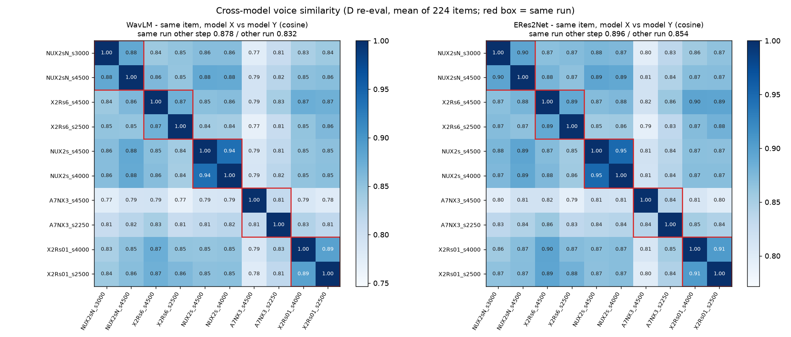
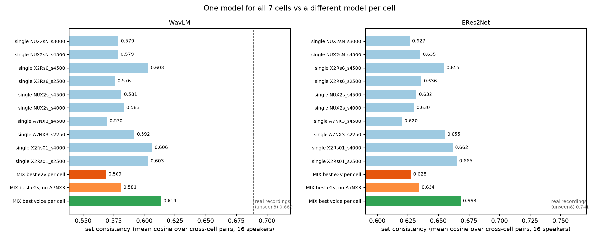

# 모델이 달라도 같은 화자는 같은 목소리로 나오는가 — 모델 간 유사도 조사 (2026-11-09)

> 지시문: [`_handoff/20261108_2325_prompt_overnight_full.md`](../../_handoff/20261108_2325_prompt_overnight_full.md) §3(q3tts 세션 작성 · 요청 1 · 가장 중요)
> 코드: [`tools/cross_model.py`](../../tools/cross_model.py)(emb · analyze · page) · 숫자: `~/workspaces/tmp_listen/vox_koft/cross_model/`(`cross_model.json` · `matrix_전체.csv` · `cell_table.csv` · `worst_pairs.csv`)
> 그림: [figs/20261109_cross_model_matrix.png](figs/20261109_cross_model_matrix.png) · [figs/20261109_cross_model_mix.png](figs/20261109_cross_model_mix.png)
> 청음(12줄): http://127.0.0.1:8765/vox_koft/cross_model/index.html

## 한 줄 답
**칸마다 다른 모델로 만들어 섞어도 목소리는 크게 흔들리지 않습니다.** 단, 아래 조건을 지켜야 합니다.
- **안전한 조합:** lr 5e-5 · "다른 칸 ref" 계열 네 run 끼리입니다(X2Rs01 · X2Rs6 · NUX2s · NUX2sN).
  - 이 계열 안에서는 같은 문장을 두 모델로 만들면 WavLM 코사인이 0.83~0.88 입니다.
  - 같은 run 의 다른 step 끼리(0.88)와 거의 같은 수준입니다.
- **피할 것:** A7NX3(lr 1e-4 · ref 3개)입니다. 특히 s4500 은 다른 모델과의 평균이 0.78 로 혼자 떨어져 있습니다. 섞기에서 가장 튀는 조합 10개 중 8개에 A7NX3 가 들어 있습니다(두 잣대 모두).
- **조건**
  - REF · seed · cfg · 문장 정규화를 모든 칸에서 똑같이 둡니다.
  - 모델 계열이 같은 것끼리만 섞습니다.
  - 칸 사이 차이는 숫자로는 작지만, 귀로 확인한 뒤에 씁니다(청음 페이지 12줄).
- **얻는 것:** A7NX3 를 빼고 칸마다 e2v 1위 모델을 골라 섞으면(조합 (라)), 7칸 e2v 맞힘이 **65.2%** 입니다.
  - 한 모델로 만들 때 가장 좋은 경우는 61.6%(A7NX3 s4500), 통합 1위 NUX2sN s3000 은 58.9% 입니다.
  - 세트 안 목소리 일관성은 0.581 로, 한 모델 10개의 평균(0.587)과 같은 수준입니다.

## 1. 무엇을 쟀나
- 대상: d_eval 통합 점수 **상위 5 run × 상위 2 step = 10 ckpt**(summary.json 에서 다시 확인 · 지시문 표와 같음).
  - NUX2sN s3000 · s4500 / X2Rs6 s4500 · s2500 / NUX2s s4500 · s4000 / A7NX3 s4500 · s2250 / X2Rs01 s4000 · s2500
- **새 합성은 없습니다.** D 재측정 음원(ckpt 마다 224개 = 화자 16명 × 14문장)을 그대로 썼습니다.
- 잣대는 D 재측정과 같은 두 화자 임베딩입니다(WavLM-large · ERes2Net). 두 잣대를 각각 적습니다. 임베딩은 CPU 로 계산했습니다(학습 ① 이 GPU 2,3 을 쓰는 중이라).
- 기준선(사람 쪽)
  - 같은 화자 진짜 녹음끼리: unseen8 화자의 칸별 진짜 녹음(`d_eval/real_cells.json` · 35개)에서 **다른 칸끼리** → WavLM 0.690 · ERes2Net 0.742
  - 같은 화자 진짜 무감정 녹음끼리(16명): 0.711 · 0.789

## 2. 같은 문항 · 다른 모델 — 10×10 행렬


| 비교 | WavLM | ERes2Net |
|---|---|---|
| 같은 run · 다른 step | **0.878** | 0.896 |
| 다른 run(전체 평균) | **0.832** | 0.854 |
| 다른 run 중 가장 낮은 쌍 | 0.767 | 0.792 |
| (참고) 같은 모델 · 같은 칸 · **다른 문장** | 0.646 | 0.713 |
| (참고) 진짜 사람 · 같은 화자 · 다른 칸 | 0.690 | 0.742 |

- "모델이 다를 때의 차이"(0.83)는 "같은 run 의 step 차이"(0.88)보다 조금 큽니다.
- 하지만 **"문장이 다를 때의 차이"(0.65)보다는 훨씬 작습니다.** 목소리를 정하는 것은 주로 REF 이고, 모델 차이는 그 위의 작은 흔들림입니다.
- 모델마다 다른 run 과의 평균(WavLM)
  - NUX2sN s4500 0.848 · X2Rs6 s4500 0.848 · NUX2s s4000 0.842 · NUX2s s4500 0.841 · X2Rs01 s2500 0.841 · X2Rs01 s4000 0.839
  - NUX2sN s3000 0.832 · X2Rs6 s2500 0.831
  - **A7NX3 s2250 0.817 · A7NX3 s4500 0.783** ← 혼자 떨어짐
- 칸별(다른 run 평균 · WavLM)
  - 중립 0.894 · 슬픔A 0.865 · 기쁨A 0.853 · 분노A 0.827 · 분노B 0.817 · 기쁨B 0.800 · **슬픔B 0.771**
  - 센 감정(B칸)일수록 모델마다 목소리가 더 다릅니다. 가장 낮은 칸은 슬픔B 입니다.
- 묶음별: 542 화자 0.841 · unseen8 0.824. 큰 차이는 없습니다.

## 3. 칸 섞어 만들기 모의실험


- **세트 안 일관성** = 화자 1명의 7칸 세트(칸마다 2문장 = 14개)에서 **다른 칸끼리** 모든 쌍의 평균 코사인, 16명 평균.
- 진짜 녹음 세트(unseen8 · 칸마다 1개)와 맞추려고 같은 칸 쌍은 셈에서 뺐습니다.

| 세트 | WavLM | ERes2Net | 7칸 e2v | 목표 유사도 |
|---|---|---|---|---|
| (가) 한 모델 — 10개 평균 | 0.587 | 0.642 | 53.6~61.6% | 0.624~0.664 |
| (가) 한 모델 — 최고(X2Rs01 s4000 / s2500) | 0.606 | 0.665 | 55.4 / 53.6% | 0.663 / 0.664 |
| (가) NUX2sN s3000(통합 1위) | 0.579 | 0.627 | 58.9% | 0.640 |
| (나) 칸마다 e2v 1위 모델 | 0.569 | 0.628 | **70.1%** | 0.637 |
| **(라) (나) 에서 A7NX3 빼고** | **0.581** | **0.634** | **65.2%** | 0.648 |
| (다) 칸마다 목표 유사도 1위 모델 | **0.614** | **0.668** | 49.1% | **0.669** |
| (참고) 진짜 녹음 · unseen8 | 0.689 | 0.741 | — | — |

- 섞은 세트는 한 모델 세트들 사이에 있습니다.
  - (나)는 한 모델 평균보다 0.018(WavLM) · 0.014(ERes2Net) 낮습니다. 한 모델 중 가장 낮은 A7NX3 s4500(0.570)과 비슷합니다.
  - (라)는 한 모델 평균과 거의 같습니다(−0.006 · −0.008).
- (다)는 목소리를 우선해서 고르면 한 모델 최고보다도 일관성이 높습니다. 대신 e2v 가 49% 로 떨어집니다. 대부분 X2Rs01 이라 사실상 "한 모델"에 가깝습니다.
- 진짜 녹음 세트(0.69)는 어떤 모델 세트보다도 일관성이 높습니다.
  - 이것은 섞기 때문이 아니라 **한 모델 안에서도 문장 · 칸마다 목소리가 흔들리기 때문**입니다(같은 칸 다른 문장 0.65).
  - 이 선은 unseen8 8명만의 값입니다. 모델 세트의 unseen8 값(0.52~0.57)과 견주면 차이가 더 큽니다.
- 칸별 선택
  - (나): 중립 A7NX3 s4500 · 기쁨A X2Rs6 s2500 · 기쁨B A7NX3 s4500 · 슬픔A NUX2sN s4500 · 슬픔B NUX2s s4000 · 분노A NUX2sN s3000 · 분노B A7NX3 s2250
  - (라): 중립 X2Rs6 s4500 · 기쁨A X2Rs6 s2500 · 기쁨B X2Rs01 s4000 · 슬픔A NUX2sN s4500 · 슬픔B NUX2s s4000 · 분노A NUX2sN s3000 · 분노B NUX2s s4500
- ⚠️ 칸마다 1위를 고른 숫자는 같은 224문항으로 고르고 같은 문항으로 쟀습니다. 그래서 e2v 70% · 65% 는 **조금 부풀려진 값**입니다. 칸마다 32문항이라 한 칸 ±8%p 는 잡음입니다.

## 4. 칸 × 모델 표 (e2v 맞힘 %, 16명 · 칸마다 32문항)
| 모델 | 중립 | 기쁨A | 기쁨B | 슬픔A | 슬픔B | 분노A | 분노B | 7칸 |
|---|---|---|---|---|---|---|---|---|
| NUX2sN s3000 | 62.5 | 53.1 | 25.0 | 37.5 | 68.8 | **78.1** | 87.5 | 58.9 |
| NUX2sN s4500 | 59.4 | 50.0 | 21.9 | **40.6** | 68.8 | 75.0 | 87.5 | 57.6 |
| X2Rs6 s4500 | 68.8 | 56.2 | 21.9 | 28.1 | 71.9 | 59.4 | 84.4 | 55.8 |
| X2Rs6 s2500 | 62.5 | **65.6** | 18.8 | 21.9 | 81.2 | 71.9 | 84.4 | 58.0 |
| NUX2s s4500 | 53.1 | 56.2 | 21.9 | 25.0 | 75.0 | 71.9 | 90.6 | 56.2 |
| NUX2s s4000 | 53.1 | 50.0 | 21.9 | 21.9 | **84.4** | 71.9 | 90.6 | 56.2 |
| A7NX3 s4500 | **87.5** | 62.5 | **40.6** | 31.2 | 59.4 | 62.5 | 87.5 | **61.6** |
| A7NX3 s2250 | 62.5 | 53.1 | 31.2 | 21.9 | 40.6 | 71.9 | **93.8** | 53.6 |
| X2Rs01 s4000 | 59.4 | 56.2 | 28.1 | 28.1 | 81.2 | 50.0 | 84.4 | 55.4 |
| X2Rs01 s2500 | 56.2 | 46.9 | 21.9 | 31.2 | 62.5 | 68.8 | 87.5 | 53.6 |

- 칸마다 강한 모델
  - 중립 · 기쁨B 는 A7NX3 s4500 이 강합니다.
  - 슬픔A · 분노A 는 NUX2sN 이 강합니다(542 지름길이 없는 판).
  - 슬픔B 는 NUX2s · X2Rs6 · X2Rs01 이 강합니다.
  - 분노B 는 모두 84~94% 라 어느 모델이나 됩니다.
- 기쁨B(19~41%) · 슬픔A(22~41%)는 **어느 모델도 약합니다.** 섞어도 이 두 칸은 크게 나아지지 않습니다.
- 목표 유사도 · 1위 비율을 포함한 전체 표: `cross_model/cell_table.csv`

## 5. 섞었을 때 가장 튀는 조합 (청음 후보)
- 기준: 섞은 세트에서 다른 모델끼리인 (화자 · 칸 쌍)의 코사인과, 같은 두 문항을 한 모델로 만들었을 때의 코사인 차이(낙차). 문장 2×2 평균.
- WavLM 상위 10개 중 8개, ERes2Net 상위 10개 중 8개에 **A7NX3** 가 들어 있습니다.

| # | 섞기 | 화자 | 모델 · 칸 | 모델 · 칸 | 코사인 | 한 모델일 때 | 낙차 |
|---|---|---|---|---|---|---|---|
| 1 | (나) | aihub_0109 | NUX2s s4000 슬픔B | A7NX3 s4500 중립 | 0.377 | 0.501 | 0.124 |
| 2 | (나) | a542_1525_JJH | NUX2sN s3000 분노A | A7NX3 s2250 분노B | 0.509 | 0.629 | 0.120 |
| 3 | (나) | a542_1099_YJS | X2Rs6 s2500 기쁨A | A7NX3 s4500 기쁨B | 0.533 | 0.639 | 0.106 |
| 4 | (나) | a542_2108_KKH | A7NX3 s4500 기쁨B | NUX2sN s3000 분노A | 0.589 | 0.691 | 0.101 |
| 5 | (나) | aihub_0115 | NUX2sN s4500 슬픔A | A7NX3 s4500 중립 | 0.502 | 0.601 | 0.100 |
| 6 | (라) | a542_1525_JJH | NUX2sN s3000 분노A | X2Rs6 s4500 중립 | 0.527 | 0.622 | 0.095 |
| 7 | (라) | a542_2108_KKH | NUX2s s4000 슬픔B | X2Rs6 s4500 중립 | 0.564 | 0.660 | 0.095 |
| 8 | (나) | a542_0270_YSJ | NUX2s s4000 슬픔B | A7NX3 s4500 중립 | 0.490 | 0.583 | 0.094 |
| 9 | (나) | a542_1525_JJH | NUX2sN s3000 분노A | A7NX3 s4500 중립 | 0.491 | 0.583 | 0.092 |
| 10 | (나) | aihub_0109 | A7NX3 s4500 기쁨B | NUX2s s4000 슬픔B | 0.376 | 0.467 | 0.092 |

- (WavLM 기준 · ERes2Net 목록은 `worst_pairs.csv`)
- (라) 에서도 낙차가 0.095 인 쌍이 있습니다(6 · 7번). 낙차 0.1 은 "같은 모델 안 문장 차이"(0.65 → 0.55 정도)와 같은 크기입니다. 귀로 들어야 판단할 수 있습니다.

## 6. 판단 · 다음
- 숫자로는 "섞어도 된다"입니다. 모델 차이가 문장 차이보다 훨씬 작고, A7NX3 를 빼면 섞은 세트의 일관성이 한 모델 세트와 같은 수준입니다.
- 섞어서 얻는 이득은 e2v 몇 %p(58.9 → 65.2%)입니다. 기쁨B · 슬픔A 같은 약한 칸은 섞어도 남습니다.
- 데이터셋을 만들 때 권하는 순서
  1. 먼저 한 모델(예: NUX2sN s3000)로 7칸을 만듭니다.
  2. 그 모델이 약한 칸만 같은 계열의 다른 모델로 바꿉니다(예: 슬픔B → NUX2s s4000).
  3. A7NX3 는 쓰지 않습니다.
  4. 바꾼 칸은 칸 쌍 코사인으로 한 번 더 거릅니다(예: 같은 화자 다른 칸과 WavLM 0.5 미만이면 다시 만들기).
- 청음: 12줄 페이지에서 "한 모델" 줄과 "섞음(라)" 줄이 둘 다 같은 사람으로 들리는지 봐 주세요.

## 한계
- 임베딩 잣대는 목소리의 "사람다움"을 다 잡지 못합니다. 판정은 청음입니다.
- 진짜 녹음 기준선은 unseen8 8명 · 35개 녹음뿐입니다(542 화자는 감정 녹음이 없음).
- 칸마다 모델을 고른 숫자와 잰 숫자가 같은 문항이라, 섞은 세트의 e2v 는 조금 부풀려져 있습니다.

## 다시 돌리기
```bash
CUDA_VISIBLE_DEVICES= ~/miniforge3/envs/q3tts/bin/python tools/cross_model.py emb --threads 48   # CPU 약 15분(GPU 면 --device cuda)
~/miniforge3/envs/voxcpm/bin/python tools/cross_model.py analyze
~/miniforge3/envs/voxcpm/bin/python tools/cross_model.py page
```
