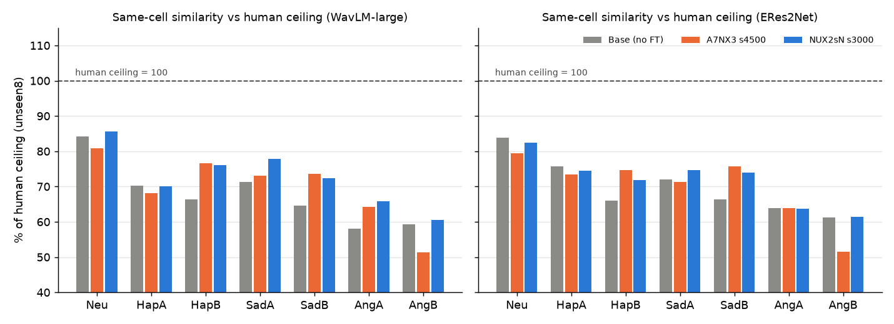
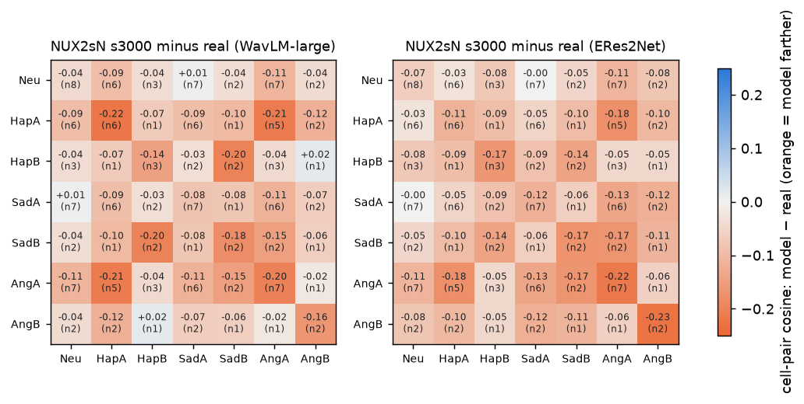

# REF 유사도 조사 — 모델 출력은 그 사람의 "같은 칸" 진짜 녹음과 얼마나 비슷한가 (2026-11-09)

> 지시문: [`_handoff/20261109_0930_prompt_bcell_ref_study_full.md`](../../_handoff/20261109_0930_prompt_bcell_ref_study_full.md) §4 · §4-1(q3tts 세션 작성 · 사용자 결정 11/09 09시) · **새 합성 없음**
> 코드: [`tools/ref_sim.py`](../../tools/ref_sim.py)(pick · emb · analyze · repro · page) · 숫자 `~/workspaces/tmp_listen/vox_koft/ref_sim/analysis.json`
> 청음 페이지(12줄): http://127.0.0.1:8765/vox_koft/ref_check/index.html
> 함께 볼 것: [모델 간 유사도](20261109_cross_model_similarity.md) · [기쁨A 조사](20261109_happyA_data_check.md)

## 한 줄 답
1. **모델 출력은 그 사람의 같은 칸 진짜 녹음과 비교해 사람 천장의 약 70% 수준입니다.**
   - NUX2sN s3000, 감정 6칸 평균: WavLM 70.4% · ERes2Net 70.0%. 중립은 86% · 82% 로 가장 높고, 분노B 는 61% 로 가장 낮습니다.
   - 사람 천장: 같은 사람의 같은 칸 진짜 녹음끼리의 유사도입니다.
   - 그래도 "누구 목소리인가"는 맞힙니다. 같은 성별 다른 화자들의 같은 칸 녹음 사이에서 목표 화자가 1위인 비율이 93~97% 입니다.
   - 공정한 잣대(같은 칸)로 바꿔도 점수가 오르지 않았습니다. 무감정 진짜 녹음과의 유사도(0.574)와 같은 칸 진짜 녹음과의 유사도(0.562 · WavLM)가 비슷합니다.
     - 즉 모델의 감정 출력은 "그 사람이 실제로 그 감정을 낼 때의 목소리" 쪽으로 가지 않습니다. 무감정 목소리에서 비슷한 거리만큼 다른 방향으로 갑니다.
2. **사람보다 많이 멀어지는 칸 쌍은 분노A 가 낀 쌍입니다.**
   - 기쁨A ↔ 분노A(WavLM −0.21 · ERes2Net −0.18), 슬픔A ↔ 분노A(−0.11 · −0.13), 중립 ↔ 분노A(−0.11 · −0.11)
   - 기쁨B ↔ 슬픔B 도 큽니다(−0.20 · −0.14). 다만 이 쌍을 잴 수 있는 화자가 2명뿐입니다.
   - 반대로 **분노A ↔ 분노B 는 사람과 같습니다**(진짜 녹음끼리도 0.550 으로 가장 멂 · 모델 0.554). 분노B 가 분노A 와 다르게 들리는 것은 사람도 그렇습니다.
3. **기쁨A 후보 중 섞기에 가장 안전한 것은 X2Rs6 s2500 입니다.**
   - NUX2sN s3000 의 다른 6칸과의 유사도 낙차: WavLM 0.000 · ERes2Net +0.002. 숫자로는 NUX2sN 자신과 같습니다. 기쁨A e2v 는 66% 로 후보 중 가장 높습니다.
   - 그다음은 A7NX3 s2250(낙차 −0.014 · −0.006 · e2v 53%)입니다.
   - A7NX3 s4500 은 낙차가 가장 큽니다(−0.033 · −0.031). 11/08 귀 판정에서 기쁨A 5/6 으로 가장 좋았던 모델이라 **청음으로 정합니다**(페이지 줄 1~6).

## 1. 왜 · 무엇을
- 지금의 "목표 유사도"는 무감정 녹음과만 비교합니다. 그런데 진짜 사람도 화내면 목소리가 달라집니다.
  - 그래서 분노B 출력이 무감정과 먼 것은 당연할 수 있습니다.
  - 공정하게 보려면 **같은 칸 진짜 녹음끼리** 비교해야 합니다(q3tts 의 "공정한 잣대"와 같은 생각).
- 재료: D 재측정 음원 임베딩(`d_eval/vspk/emb_<tag>.npz` · 16명 × 7칸 × 2문장) 재사용
- 잣대: WavLM-large · ERes2Net(d_eval 과 같은 `q3ko.eval.sv.load_embedder`) · 코사인
- 대상 9개: NUX2sN s3000 · s4500 / A7NX3 s4500 · s2250 / X2Rs6 s4500 · s2500 / X2Rs01 s4000 / NUX2s s4000 / 원본(base)
  - B칸 판(A7NUX2sNp) 1위 step s4000 은 평가가 끝난 뒤 `analyze --extra_tags NUX2sNplr5e5_s4000` 로 넣었습니다.
    - 감정 6칸 평균은 WavLM 70.1% · ERes2Net 69.2% 로 NUX2sN s3000 과 같은 수준입니다. 분노B 는 58% · 54% 로 조금 낮지만 화자 2명입니다 — [B칸 판 보고서](20261109_A7NUX2sNp_results.md)
- 진짜 녹음(`ref_sim.py pick`)
  - unseen8 8명: 71349 원본(metadata.csv). 칸마다 최대 10개를 골랐습니다.
    - 고른 조건: 강도 1 → A, 2·3 → B, 무감정은 강도 0 · 투표 평균 4.0 이상 · 2~10초
    - 뺀 것: REF · D 재측정 문장 · 감정 ref 판 ref 와 겹치는 녹음 · seed 1986
  - 542 8명: 무감정만 있습니다. REF(긴 ref 에 이어 붙인 문장)와 글이 겹치는 녹음을 빼고 최대 10개입니다.
  - 다른 화자 후보(1위 비율용): 71349 화자 중 **어느 학습셋에도 없는** 22명입니다(여 12 · 남 10 · unseen8 제외).
    - 칸마다 3개 이상 있는 화자: 중립 22 · 기쁨A 18 · 슬픔A 21 · 분노A 17명 · B칸은 1~4명뿐입니다(B칸 1위 비율은 참고용).
- unseen8 화자가 녹음한 칸은 사람마다 다릅니다. 7칸이 모두 있는 사람은 aihub_0012 하나이고, 나머지는 3~4칸입니다. 칸마다 쓴 사람 수는 표의 n 을 보세요.

## 2. (가) 같은 칸 비교 — unseen8 · 진짜 녹음 10개 평균 대비


| 모델(WavLM · 사람 천장 대비) | 중립 | 기쁨A | 기쁨B | 슬픔A | 슬픔B | 분노A | 분노B | 감정 6칸 평균 |
|---|---|---|---|---|---|---|---|---|
| 사람 천장(코사인) | 0.801 | 0.807 | 0.807 | 0.778 | 0.808 | 0.801 | 0.789 | |
| **NUX2sN s3000** | 86% | 70% | 76% | 78% | 72% | 66% | 61% | **70.4%** |
| NUX2sN s4500 | 86% | 71% | 79% | 78% | 69% | 64% | 61% | 70.3% |
| A7NX3 s4500 | 81% | 68% | 77% | 73% | 74% | 64% | 51% | 67.8% |
| A7NX3 s2250 | 83% | 68% | 79% | 77% | 71% | 66% | 59% | 70.1% |
| X2Rs6 s4500 | 87% | 71% | 77% | 78% | 71% | 65% | 61% | 70.5% |
| X2Rs6 s2500 | 85% | 67% | 68% | 78% | 68% | 62% | 57% | 66.8% |
| X2Rs01 s4000 | 86% | 72% | 78% | 77% | 70% | 66% | 60% | 70.5% |
| NUX2s s4000 | 87% | 72% | 79% | 79% | 71% | 66% | 58% | 70.7% |
| 원본(base) | 84% | 70% | 66% | 71% | 65% | 58% | 59% | 65.0% |

- ERes2Net 도 같은 모양입니다. NUX2sN s3000 의 감정 6칸 평균은 70.0% 이고, 분노A 64% · 분노B 61% 가 가장 낮습니다(원본 67.6%).
- 칸마다 쓴 사람 수(n): 중립 8 · 기쁨A 6 · 슬픔A 7 · 분노A 7 · 기쁨B 3 · 슬픔B 2 · 분노B 2. B칸은 2~3명이라 흔들림이 큽니다.
- 학습은 B칸 · 분노A 를 원본보다 사람 쪽으로 당겼습니다(기쁨B 66 → 76% · 슬픔B 65 → 72% · 분노A 58 → 66%). 기쁨A 는 원본과 같습니다(70%).
- 1위 비율(같은 칸 진짜 녹음 중심 중 목표가 1위): 학습 모델 87~98%(두 잣대 · 7칸 평균) · 원본 93~95% · 사람 100%. 목소리 정체성은 대체로 지켜집니다.
- **주의**: 사람 천장은 같은 녹음실 · 같은 날 녹음끼리라 녹음 환경 몫이 들어 있습니다. 그래서 100% 는 도달 목표가 아니라 위쪽 끝입니다. 모델끼리 비교하는 데 쓰세요.
- 무감정 진짜 녹음 대비(지금 잣대)와 같은 칸 대비(공정한 잣대)는 감정 6칸 평균이 거의 같습니다(NUX2sN s3000 WavLM 0.574 vs 0.562 · ERes2Net 0.616 vs 0.603).
  - 사람이라면 같은 칸 쪽이 훨씬 가깝습니다(분노B: 같은 칸 0.789 · 무감정 0.648).
  - 모델의 감정 출력은 그 사람의 실제 감정 목소리 쪽으로 가지 않습니다.

## 3. (나) REF 개수 효과 — 16명 · 무감정 진짜 녹음 N개
| 모델(WavLM · 7칸 출력 평균) | N=1 | N=3 | N=5 | N=10 |
|---|---|---|---|---|
| X2Rs01 s4000 | 0.609 | 0.601 | 0.603 | 0.601 |
| X2Rs6 s4500 | 0.606 | 0.598 | 0.599 | 0.599 |
| A7NX3 s2250 | 0.595 | 0.588 | 0.591 | 0.590 |
| NUX2s s4000 | 0.593 | 0.589 | 0.590 | 0.589 |
| NUX2sN s3000 | 0.587 | 0.583 | 0.585 | 0.584 |
| A7NX3 s4500 | 0.569 | 0.563 | 0.565 | 0.564 |
| 원본(base) | 0.523 | 0.526 | 0.527 | 0.524 |

- **N 에 따라 결론이 바뀌지 않습니다.**
  - 위 2개(X2Rs01 s4000 · X2Rs6 s4500)와 아래 2개(A7NX3 s4500 · 원본)는 N = 1 · 3 · 5 · 10 모두 같은 자리입니다.
  - 가운데 모델들은 0.005 안에서 자리만 바뀝니다. ERes2Net 도 같습니다.
- 값도 N 에 거의 무관합니다(±0.008). "평균 코사인"은 녹음 수를 늘려도 커지지 않기 때문입니다. REF 하나로 잰 지금 점수로 모델 순위를 매겨도 됩니다.

## 4. (다) 칸 쌍 표 — 모델이 사람보다 더 멀어지는 쌍


- 값 = (모델의 같은 화자 칸 a 출력 ↔ 칸 b 출력 평균 코사인) − (같은 사람 진짜 칸 a ↔ 칸 b 녹음 평균) · unseen8 중 두 칸이 모두 있는 화자만(괄호 n)
- 대각선(같은 칸 두 문장끼리)도 넣었습니다.
  - 모델은 같은 칸 안에서도 사람보다 0.1~0.2 덜 비슷합니다. 문장이 바뀌면 목소리가 조금씩 흔들린다는 뜻입니다(같은 녹음실 효과도 섞여 있음).
- NUX2sN s3000 · 사람 대비 많이 멀어지는 칸 쌍(대각선 빼고 · WavLM · ERes2Net)

| 칸 쌍 | WavLM | ERes2Net | 화자 수 | 진짜끼리 → 모델 |
|---|---|---|---|---|
| 기쁨A ↔ 분노A | −0.21 | −0.18 | 5 | 0.697 → 0.510 |
| 기쁨B ↔ 슬픔B | −0.20 | −0.14 | 2 | 0.738 → 0.472 |
| 슬픔B ↔ 분노A | −0.15 | −0.17 | 2 | 0.667 → 0.413 |
| 기쁨A ↔ 분노B | −0.12 | −0.11 | 2 | 0.680 → 0.558 |
| 슬픔A ↔ 분노A | −0.11 | −0.13 | 6 | 0.680 → 0.561 |
| 중립 ↔ 분노A | −0.11 | −0.11 | 7 | 0.709 → 0.593 |
| 중립 ↔ 기쁨A | −0.09 | −0.03 | 6 | 0.731 → 0.646 |
| 분노A ↔ 분노B | −0.02 | −0.06 | 1 | 0.550 → 0.554 |

- **분노A 가 다른 칸들과 멀어지는 것**이 가장 일관된 모양입니다. 5~7명에서 나오고, 두 잣대 모두 −0.11 ~ −0.21 입니다.
  - 지금까지는 분노B 를 걱정했습니다. 그러나 분노B 는 사람도 다른 칸과 멀어서(중립 ↔ 분노B 진짜 0.648) 사람 대비 낙차는 작습니다(−0.04 · −0.08).
- 원본(base)은 모든 쌍에서 더 멉니다(기쁨A ↔ 분노A −0.24 · 기쁨B ↔ 슬픔B −0.26). 학습이 칸 사이 목소리를 많이 모아 주었지만 분노A 쌍은 덜 모였습니다.
- 16명 표(542 포함 · 진짜 비교 없음)도 같은 모양입니다 — `analysis.json` `da.*.model_16`.

## 5. (라) 기쁨A 후보 섞기 — NUX2sN s3000 의 다른 6칸과 같은 사람인가
| 기쁨A 후보 | WavLM 유사도(낙차) | ERes2Net 유사도(낙차) | 화자별 최악 낙차 W · E | 기쁨A e2v | 11/08 귀(기쁨A OK) |
|---|---|---|---|---|---|
| NUX2sN s3000(자신 · 기준) | 0.579 | 0.655 | – | 53% | 2/6 |
| **X2Rs6 s2500** | 0.579(0.000) | 0.657(+0.002) | −0.050 · −0.029 | **66%** | (s4500 1/6) |
| A7NX3 s2250 | 0.565(−0.014) | 0.649(−0.006) | −0.044 · −0.040 | 53% | – |
| A7NX3 s4500 | 0.546(−0.033) | 0.624(−0.031) | −0.080 · −0.070 | 62% | **5/6** |

- 값 = 같은 화자의 기쁨A 후보 출력 2개 ↔ NUX2sN s3000 의 다른 6칸 출력 12개 평균 코사인 · 16명 평균
- [모델 간 유사도](20261109_cross_model_similarity.md)에서 A7NX3 를 빼라고 한 것과 같은 방향입니다. A7NX3 s4500 이 가장 멀고, 같은 run 의 s2250 은 훨씬 가깝습니다.
- 숫자로는 X2Rs6 s2500 이 가장 안전하고 e2v 도 가장 높습니다. 다만 11/08 귀 판정에서 X2Rs6(s4500) 기쁨A 는 1/6 이었습니다. **판정은 청음 페이지 줄 1~6** 으로 합니다.

## 6. 청음 페이지(§4-1 · 12줄)
- 주소: http://127.0.0.1:8765/vox_koft/ref_check/index.html · 저장 키 `refchk_judg` · CSV `vox_koft_ref_check.csv`
- 줄 1~6: 기쁨A 후보입니다(화자 6명 공통 세트 · "바다가 너무 예뻐서 기분이 좋았어.").
  - 한 줄에 REF · NUX2sN s3000 중립(기준) · 후보 4개를 둡니다.
  - 후보마다 "중립과 같은 사람?"(같음 · 애매 · 다름)과 "기쁨?"(OK · 약함 · 틀림)을 누릅니다.
- 줄 7~12: (다)에서 사람 대비 낙차가 가장 큰 화자 · 칸 쌍 6개입니다(두 잣대 평균).
  - aihub_0115 기쁨A ↔ 분노A(−0.24) · aihub_0012 슬픔B ↔ 분노A(−0.22) · aihub_0152 중립 ↔ 분노A(−0.20) · aihub_0012 기쁨B ↔ 슬픔B(−0.20) · aihub_0152 기쁨A ↔ 분노A(−0.19) · aihub_0156 기쁨A ↔ 분노A(−0.19)
  - 출력 두 칸과 진짜 두 칸 녹음을 함께 둡니다. 버튼은 "같은 사람?" 하나입니다.
- 재현: 노트북 엔진(`voxko.listen.Listener`)으로 모델마다 1개씩, NUX2sN 은 중립 문항까지 다시 만들었습니다. 5/5 가 같은 소리였습니다(길이 같음 · max diff < 1e-3). 확인한 뒤 공개했습니다.
- 검사: 오디오 66개 경로 0 깨짐 · JS(quickjs) 버튼 · 메모 · CSV 동작 · HTTP 200

## 다시 돌리기
```bash
~/miniforge3/envs/voxcpm/bin/python tools/ref_sim.py pick
CUDA_VISIBLE_DEVICES=3 ~/miniforge3/envs/q3tts/bin/python tools/ref_sim.py emb
~/miniforge3/envs/voxcpm/bin/python tools/ref_sim.py analyze
CUDA_VISIBLE_DEVICES=3 ~/miniforge3/envs/voxcpm/bin/python tools/ref_sim.py repro
~/miniforge3/envs/voxcpm/bin/python tools/ref_sim.py page
```
